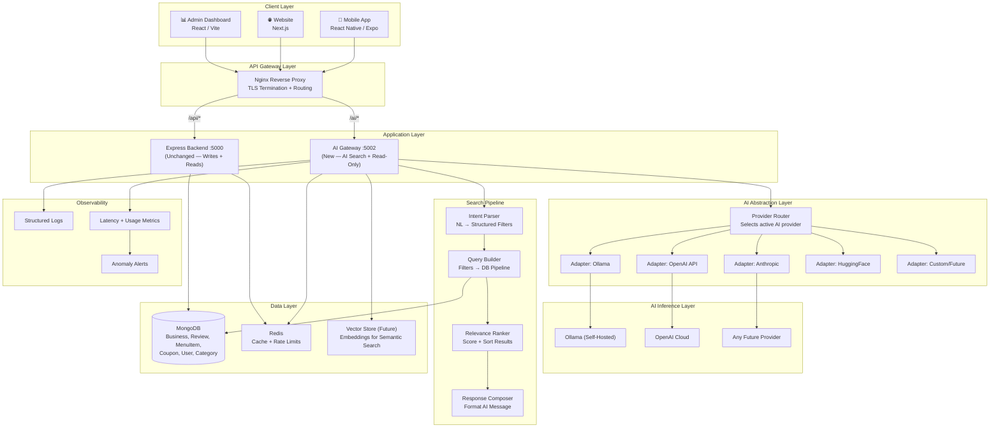
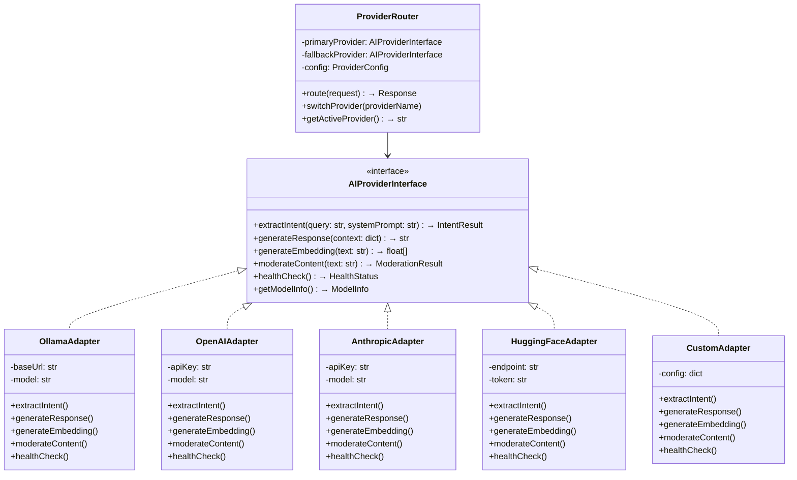
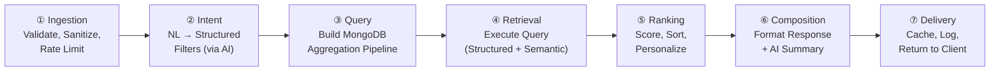
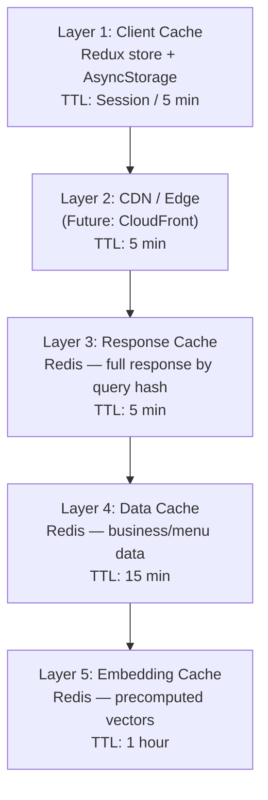
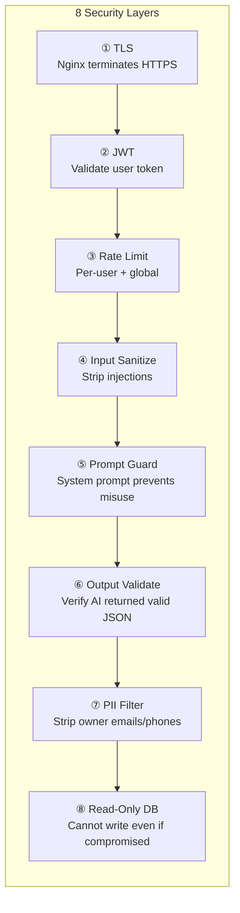
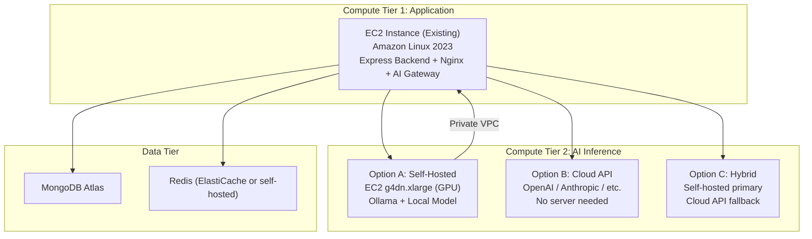
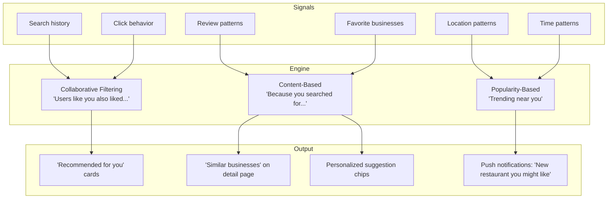
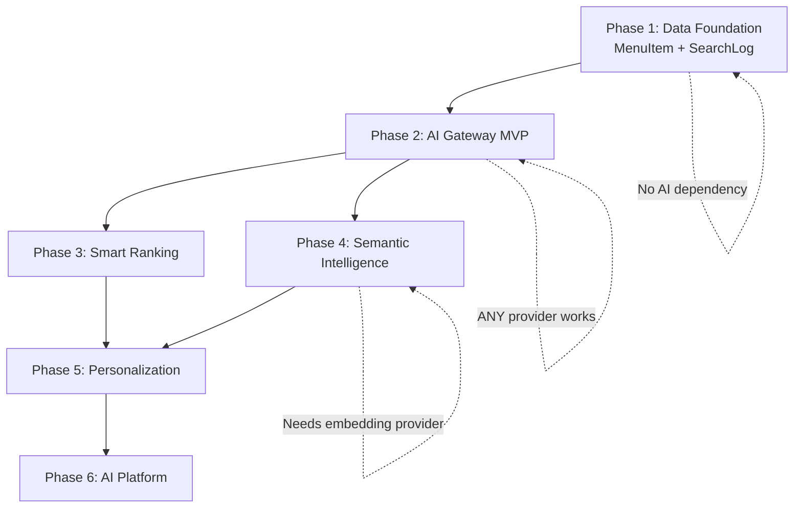

# HashView AI Master Strategy
## Complete Long-Term Architecture, Roadmap & Strategic Plan

**Document Status:** Master Strategy (Pre-Implementation)
**Last Updated:** 2026-05-24
**Scope:** Full AI integration lifecycle — from MVP to AI-powered discovery platform

---

# Part I: Strategic Vision

## 1.1 Where HashView Is Today

HashView is a multi-tier business review and engagement ecosystem:

| Component | Tech | Role |
|---|---|---|
| **Mobile App** | React Native / Expo | User-facing: browse businesses, write reviews, claim coupons |
| **Express Backend** | Node.js / Express / MongoDB / Socket.io | Central API engine, JWT auth, real-time chat |
| **Admin Dashboard** | React / Vite | Internal admin: approvals, analytics, user management |
| **Website** | Next.js (App Router) | Marketing portal, QR lead capture, SEO |

**Current data assets:**
- `Business` — name, category, location (2dsphere), address, ratings, opening hours, images, external profiles (Google, TripAdvisor)
- `Review` — user ratings (1-5), comments, category ratings (staff, cleanliness, value), images, videos, geolocation, security metadata
- `Coupon` — promotions tied to businesses, reward types, claim/redeem tracking
- `Category` — dynamic business categories (restaurant, salon, hotel, cafe, etc.)
- `User` — profiles, roles, favorites, auth credentials
- **No menu/service/pricing data exists yet**

**Current search:** Keyword regex on `name`, `description`, `address` + geospatial `$geoNear` aggregation + category filter + rating filter. Functional but not intelligent.

## 1.2 Where HashView Needs to Go

**Transform from:** A business listing + review platform
**Transform into:** The UK's first AI-powered local business discovery engine

The AI should feel like a **smart search bar that understands natural language** — NOT a chatbot. Users type what they want in plain English and get instantly relevant business results.

**Target experience:**
```
User types:  "chicken under £15 near me"
App returns:  4 restaurants within 2km that have chicken menu items under £15,
              sorted by rating and distance, with the matching menu item shown
              on each business card.
```

## 1.3 Guiding Principles

These principles govern EVERY architectural decision in this document:

| # | Principle | What It Means |
|---|---|---|
| 1 | **Provider Agnostic** | The system MUST work with ANY AI model/provider. Switching from Ollama to OpenAI to Anthropic to a custom model should require changing ONE configuration file, not rewriting code. |
| 2 | **Data Over Model** | The AI's value comes from HashView's unique data (menus, reviews, locations, user behavior) — NOT from the model itself. Models are replaceable; your data moat is not. |
| 3 | **Discovery, Not Chat** | The AI is a smart search engine. Stateless queries. No conversation memory in V1. No chatbot patterns. |
| 4 | **Structured First, Semantic Later** | Start with deterministic structured extraction (filters → MongoDB queries). Layer in semantic/vector search only after data density justifies it. |
| 5 | **Security by Architecture** | AI reads data through a read-only database connection. It cannot write, modify, or delete. Security is enforced at the infrastructure level, not the code level. |
| 6 | **Progressive Enhancement** | Every phase builds on the last. No phase requires rewriting work from previous phases. No dead-end decisions. |
| 7 | **Cost Proportional to Users** | Infrastructure costs should scale with actual usage, not with ambition. Don't pay for GPU instances until you need them. |

---

# Part II: Core Architecture

## 2.1 System Architecture — Complete Overview



## 2.2 AI Provider Abstraction Layer — The Critical Design

This is the architectural core that makes the entire system model-agnostic and provider-agnostic. Every AI call in the system flows through this abstraction.

### The Adapter Pattern



### How Provider Switching Works

```
# Configuration file (environment variables or config.yaml)
AI_PRIMARY_PROVIDER=ollama            # or: openai, anthropic, huggingface, custom
AI_FALLBACK_PROVIDER=openai           # automatic fallback if primary fails
AI_OLLAMA_BASE_URL=http://10.0.1.5:11434
AI_OLLAMA_MODEL=qwen2.5:7b
AI_OPENAI_API_KEY=sk-xxx
AI_OPENAI_MODEL=gpt-4o-mini
AI_ANTHROPIC_API_KEY=xxx
AI_ANTHROPIC_MODEL=claude-3-haiku
```

**To switch providers:** Change `AI_PRIMARY_PROVIDER` in one config file. Zero code changes. Zero redeployment of the main backend. The AI Gateway reads the config, instantiates the correct adapter, and routes all requests through it.

**Automatic failover:** If the primary provider is down (Ollama server crashed, API key expired, rate limited), the ProviderRouter automatically falls back to the secondary provider. If BOTH are down, the AI Gateway returns a graceful "AI search temporarily unavailable" response and the app continues working with traditional search.

### Provider Interface Contract

Every adapter MUST implement these methods. The calling code never knows which provider is behind the interface:

| Method | Input | Output | Purpose |
|---|---|---|---|
| `extractIntent` | User query (string) + system prompt | Structured JSON filters | Core NLU: natural language → search parameters |
| `generateResponse` | Context dict (businesses found, filters, query) | Human-friendly message string | Compose "Found 4 restaurants near you..." |
| `generateEmbedding` | Text string | Float vector (768–1536 dimensions) | For semantic/vector search (Phase 4+) |
| `moderateContent` | Text string | Safety score + flags | Review moderation, query safety check |
| `healthCheck` | None | Status + latency | Provider availability monitoring |
| `getModelInfo` | None | Model name, version, capabilities | For observability and debugging |

### Why This Matters

| Scenario | Without Abstraction | With Abstraction |
|---|---|---|
| You want to try GPT-4o-mini instead of Ollama | Rewrite intent parser, change all API calls, update error handling, redeploy | Change 1 env var: `AI_PRIMARY_PROVIDER=openai` |
| Ollama server goes down at 2 AM | AI search is completely broken until you wake up | Auto-fallback to cloud provider, zero downtime |
| A better open-source model releases | Manual migration, test everything, hope nothing breaks | `ollama pull newmodel` + change `AI_OLLAMA_MODEL=newmodel` |
| You want to A/B test two models | Impossible without running two separate systems | ProviderRouter supports weighted traffic splitting |
| You want to use different models for different tasks | Everything uses the same model even if suboptimal | Route `extractIntent` to Model A, `generateEmbedding` to Model B |

---

## 2.3 The Search Pipeline — 7 Layers

Every AI search request flows through these 7 layers sequentially. Each layer is independent, testable, and replaceable.



| Layer | Responsibility | Provider Dependency | Replaceable? |
|---|---|---|---|
| **① Ingestion** | JWT auth, rate limiting, input sanitization, query length validation | None — pure logic | Always stays the same |
| **② Intent** | Send user query to AI provider → receive structured JSON filters | **YES** — uses AI Provider Adapter | Swap any provider, same output format |
| **③ Query** | Convert structured filters → MongoDB aggregation pipeline (with `$geoNear`, `$match`, `$lookup` for menus) | None — deterministic logic | Same regardless of AI provider |
| **④ Retrieval** | Execute query against MongoDB. Future: also query vector store for semantic matches | MongoDB (structured), Vector Store (semantic) | Vector store is pluggable |
| **⑤ Ranking** | Score results by relevance (distance weight, rating weight, menu match weight, recency, popularity). Future: personalization signals. | None — algorithm logic | Tunable weights, no AI needed |
| **⑥ Composition** | Generate short human-friendly summary ("Found 4 restaurants..."). Optionally uses AI. | **Optional** — can use template or AI | Templates work without any AI provider |
| **⑦ Delivery** | Cache result in Redis, log search event for analytics, return response | None — infrastructure | Always stays the same |

### Why 7 Layers?

**Resilience:** If the AI provider is completely down, layers ①③④⑤⑥⑦ still work. Layer ② falls back to a keyword-based intent parser (regex rules like "restaurant" → category:restaurant, "£15" → price_max:15). The user still gets results — just less intelligently parsed.

**Testing:** Each layer can be unit-tested independently. You can test the query builder without ever calling an AI model.

**Performance:** Caching happens at multiple layers. If a query hash matches cache (Layer ①), you skip layers ②③④⑤⑥ entirely.

---

# Part III: Database Evolution Strategy

The database evolves across 4 stages. Each stage adds new collections/fields that enable new AI capabilities. **No stage requires modifying existing collections in breaking ways.**

## 3.1 Database Evolution Roadmap

```mermaid
timeline
    title HashView Database Evolution
    section Stage 1: Data Foundation
        MenuItem Model : Menu items, services, pricing
        Text Indexes : Full-text search on menus + descriptions
    section Stage 2: Intelligence Infrastructure
        SearchLog Model : Every AI search logged for analytics
        AIFeedback Model : User clicks, dismissals, query refinements
    section Stage 3: Semantic Layer
        EmbeddingStore : Vector embeddings for businesses, menus, reviews
        Vector Indexes : MongoDB Atlas Vector Search or external store
    section Stage 4: Personalization
        UserPreference Model : Learned preferences per user
        BusinessSignals : Trending scores, seasonal patterns
```

### Stage 1: MenuItem Model (Phase 1 prerequisite)

```
MenuItem
├── business          → ObjectId ref Business (indexed)
├── name              → String ("Chicken Tikka Masala")
├── description       → String ("Tender chicken in creamy sauce...")
├── price             → Number (12.99)
├── currency          → String (GBP, USD, EUR, INR)
├── category          → String ("Main Course", "Haircut", "Room")
├── type              → Enum (food, drink, service, product, package)
├── tags              → [String] (["chicken", "spicy", "curry", "indian"])
├── dietary           → [Enum] (vegetarian, vegan, halal, gluten-free, etc.)
├── isAvailable       → Boolean
├── availableDays     → [Enum] (mon-sun)
├── availableTimeSlots → [{start, end}]
├── image             → {url, publicId}
├── isPopular         → Boolean
├── duration          → Number (minutes, for services)
├── sortOrder         → Number
├── status            → Enum (active, inactive)
└── timestamps

Indexes:
├── { business: 1, status: 1, type: 1 }
├── { name: 'text', description: 'text', tags: 'text' }
├── { price: 1 }
└── { tags: 1 }
```

### Stage 2: SearchLog + AIFeedback Models (Phase 2+)

```
SearchLog
├── user              → ObjectId ref User
├── query             → String (raw user query)
├── intent            → Object (extracted filters JSON)
├── provider          → String (which AI provider was used)
├── resultCount       → Number
├── resultBusinessIds → [ObjectId]
├── latency           → Object { intent_ms, query_ms, total_ms }
├── cached            → Boolean
├── location          → {type: Point, coordinates: [lng, lat]}
├── sessionId         → String
├── feedback          → Enum (null, helpful, not_helpful)
└── timestamps

AIFeedback
├── searchLog         → ObjectId ref SearchLog
├── user              → ObjectId ref User
├── businessClicked   → ObjectId ref Business (which result they tapped)
├── position          → Number (rank position of clicked result)
├── action            → Enum (clicked, dismissed, refined_query, favorited)
└── timestamps
```

**Why log everything?** This data becomes the training signal for the ranking algorithm. If users consistently click the 3rd result instead of the 1st, the ranking weights need adjustment. If users frequently refine "restaurant" queries to add "near me", the AI should learn to infer location.

### Stage 3: EmbeddingStore (Phase 4+)

```
EmbeddingStore
├── sourceType        → Enum (business, menuItem, review)
├── sourceId          → ObjectId (ref to Business, MenuItem, or Review)
├── text              → String (the text that was embedded)
├── embedding         → [Number] (vector, 768-1536 dimensions)
├── model             → String (which embedding model generated this)
├── version           → Number (re-embed when model changes)
└── timestamps

Index:
└── Vector index on embedding field (provider-dependent)
```

**Provider-agnostic embedding storage:** The `model` and `version` fields ensure you can re-embed when switching providers. Old embeddings from Model A don't get mixed with new embeddings from Model B.

### Stage 4: UserPreference (Phase 5+)

```
UserPreference
├── user              → ObjectId ref User (unique)
├── preferredCategories → [{ category: String, weight: Number }]
├── priceRange        → { min: Number, max: Number, currency: String }
├── dietaryPreferences → [String]
├── favoriteAreas     → [{ city: String, area: String, weight: Number }]
├── searchPatterns    → [{ query: String, frequency: Number }]
├── lastUpdated       → Date
└── timestamps
```

**How it's built:** No user input required. Computed automatically from `SearchLog` and `AIFeedback` data. "You searched for halal restaurants 12 times in 3 months" → `dietaryPreferences: ['halal']`.

---

# Part IV: AI Gateway — Detailed Architecture

## 4.1 Gateway Technology

The AI Gateway is a **separate microservice** from the Express backend.

**Language recommendation for gateway:** Python (FastAPI) preferred due to superior AI ecosystem, but the abstraction layer design works in any language. The system prompt contract and provider interface are language-agnostic.

**However — because the system is model AND runtime agnostic:**
- If your team prefers Node.js → build in Express/Fastify with HTTP calls to any AI provider
- If you later want Python → rewrite only the gateway, everything else stays
- The interface contract (input/output shapes) is what matters, not the implementation language

## 4.2 Gateway Directory Structure

```
ai-gateway/
├── config/
│   ├── settings                  # All env vars and config loading
│   ├── database                  # Read-only DB connection
│   └── redis                     # Cache connection
│
├── providers/                    # ← THE PROVIDER ABSTRACTION LAYER
│   ├── interface                 # Abstract base: extractIntent, generateResponse, etc.
│   ├── ollama_adapter            # Ollama implementation
│   ├── openai_adapter            # OpenAI implementation
│   ├── anthropic_adapter         # Anthropic implementation
│   ├── huggingface_adapter       # HuggingFace implementation
│   ├── mock_adapter              # For testing without any real AI
│   └── router                    # Selects provider, handles failover
│
├── pipeline/                     # ← THE 7-LAYER SEARCH PIPELINE
│   ├── ingestion                 # Layer 1: validate, sanitize, rate limit
│   ├── intent_parser             # Layer 2: AI-powered intent extraction
│   ├── query_builder             # Layer 3: filters → MongoDB pipeline
│   ├── retriever                 # Layer 4: execute queries (structured + semantic)
│   ├── ranker                    # Layer 5: score and sort results
│   ├── composer                  # Layer 6: format response message
│   └── delivery                  # Layer 7: cache, log, return
│
├── prompts/                      # ← SYSTEM PROMPTS (versioned, provider-agnostic)
│   ├── intent_extraction         # System prompt for extracting search filters
│   ├── response_generation       # System prompt for composing friendly messages
│   └── moderation                # System prompt for content safety checks
│
├── middleware/
│   ├── auth                      # JWT verification
│   ├── rate_limiter              # Per-user + global rate limiting
│   └── sanitizer                 # Input sanitization, injection prevention
│
├── routes/
│   ├── search                    # POST /ai/search — main search endpoint
│   ├── suggestions               # GET /ai/suggestions — quick chips
│   ├── health                    # GET /ai/health — monitoring
│   └── admin                     # GET /ai/admin/stats — admin analytics
│
├── models/
│   └── schemas                   # Request/response data validation
│
├── utils/
│   ├── logger                    # Structured logging
│   ├── metrics                   # Latency tracking, usage counting
│   └── pii_filter                # Strip personal data from responses
│
└── tests/
    ├── test_intent_parser        # 50+ query variations
    ├── test_query_builder        # Filter → pipeline correctness
    ├── test_providers            # Each adapter individually
    ├── test_pipeline             # End-to-end with mock adapter
    └── test_security             # Injection, rate limits, PII
```

## 4.3 Prompt Engineering Strategy (Provider-Agnostic)

System prompts are the instruction sets sent to whatever AI model is active. They must work across ALL providers.

### Design Principles for Prompts

1. **Output format is always JSON** — every provider can output JSON. No provider-specific features (no OpenAI function calling, no Anthropic XML tags)
2. **Clear delimiters** — `[SYSTEM]`, `[USER]`, `[OUTPUT]` sections clearly separated
3. **Examples included** — few-shot examples in the prompt work with every provider
4. **Versioned** — prompts have version numbers. When you improve a prompt, increment version. Logs record which prompt version was used.
5. **No provider-specific syntax** — no `<tool_use>` tags, no `functions` array. Pure text instructions.

### Intent Extraction Prompt Structure

```
[SYSTEM]
You are a business search filter extractor for HashView, a UK-based business 
discovery platform. Your ONLY task is to extract structured search parameters 
from natural language queries.

OUTPUT FORMAT: Valid JSON only. No explanation. No markdown.

AVAILABLE FILTERS:
{filter_schema_injected_here}

BUSINESS CATEGORIES: {categories_from_database}

RULES:
{numbered_extraction_rules}

EXAMPLES:
{few_shot_examples}

[USER QUERY]
{actual_user_query}
```

**This prompt template works identically with Ollama, OpenAI, Anthropic, Mistral, or any instruction-following model.** The `filter_schema`, `categories`, and `examples` are injected dynamically from the database and config — not hardcoded.

### Prompt Versioning

```
prompts/
├── intent_extraction_v1          # Initial version
├── intent_extraction_v2          # Improved after analyzing SearchLog data
├── intent_extraction_v3          # Added menu-aware extraction
└── intent_extraction_latest → v3 # Symlink/alias to current production version
```

Every `SearchLog` entry records which prompt version was used. This lets you A/B test prompt improvements.

---

# Part V: Search & Ranking System

## 5.1 Query Types and How They're Handled

| Query Type | Example | Handler | AI Required? |
|---|---|---|---|
| **Category** | "restaurants" | Direct MongoDB filter on `Business.category` | ❌ Regex fallback works |
| **Location** | "near me" / "in Manchester" | `$geoNear` with user coords / `address.city` match | ❌ No |
| **Rating** | "best" / "top rated" / "4+ stars" | Sort by `rating.average` DESC / `$gte` filter | ❌ No |
| **Price** | "under £15" / "cheap" | `MenuItem.price` filter via `$lookup` | ❌ Regex can extract £ amounts |
| **Menu keyword** | "chicken" / "haircut" | Text search on `MenuItem.name` + `tags` | ❌ Regex can extract nouns |
| **Time** | "open now" / "tonight" | `Business.openingHours` check against current time | ❌ No |
| **Deals** | "any offers" / "deals" | `$lookup` to `Coupon` where `status: active` | ❌ Keyword match |
| **Combined** | "chicken under £15 near me" | All of the above composed | ✅ AI combines them intelligently |
| **Semantic** | "cozy romantic dinner" | Vector similarity on descriptions + reviews | ✅ Requires embeddings (Phase 4) |
| **Sentiment** | "good service" / "clean rooms" | Review `categoryRatings.staff` or text analysis | ✅ Requires NLP (Phase 4) |

### The Deterministic Fallback Rule

> [!IMPORTANT]
> **If the AI provider is completely unavailable, the search pipeline MUST still return useful results.** The system includes a rule-based intent parser (regex patterns + keyword lists) as a zero-dependency fallback. It handles 60-70% of query types without any AI.

**Fallback rules (no AI needed):**
```
"restaurant|cafe|salon|hotel|gym|spa|bar|pub" → category filter
"near me|nearby"                              → location: near_user
"in {city}"                                   → location: city
"£{number}|under {number}"                    → price_max
"best|top|highest"                            → sort: rating DESC
"cheap|affordable|budget"                     → sort: price ASC
"open|now|tonight"                            → is_open_now: true
"deal|offer|coupon|discount"                  → has_coupons: true
"halal|vegan|vegetarian"                      → dietary filter
```

## 5.2 Relevance Ranking Algorithm

Results are scored using a **weighted multi-factor scoring function**. This runs AFTER MongoDB retrieval and BEFORE response composition.

```
relevance_score = (
    w1 × distance_score      +    # Closer = higher (exponential decay)
    w2 × rating_score         +    # Higher rating = higher
    w3 × menu_match_score     +    # Menu keyword/price match quality
    w4 × recency_score        +    # Recent reviews = higher
    w5 × popularity_score     +    # Visit count, review count
    w6 × coupon_bonus         +    # Active coupons boost visibility
    w7 × verification_bonus   +    # Verified/claimed businesses rank higher
    w8 × personalization_score     # User preference match (Phase 5)
)
```

**Default weights (tunable via config, no code changes):**

| Factor | Weight | Rationale |
|---|---|---|
| `distance_score` | 0.30 | Location is the #1 relevance signal for local discovery |
| `rating_score` | 0.25 | Quality matters, but shouldn't dominate over distance |
| `menu_match_score` | 0.20 | Direct answer to what the user asked for |
| `recency_score` | 0.10 | Recent activity indicates an active, living business |
| `popularity_score` | 0.05 | Popularity is a weak signal (can be gamed) |
| `coupon_bonus` | 0.05 | Businesses with deals are more attractive |
| `verification_bonus` | 0.03 | Verified businesses are more trustworthy |
| `personalization_score` | 0.02 | Minimal in V1, grows as user data accumulates |

**Scoring functions:**

```
distance_score(d_km) = max(0, 1 - (d_km / max_radius))
    # 0km = 1.0, 5km = 0.5 (if max_radius=10km), 10km+ = 0.0

rating_score(r) = r / 5.0
    # 5.0 stars = 1.0, 3.0 stars = 0.6, 0.0 = 0.0

menu_match_score(query, items) = max(
    exact_name_match × 1.0,
    tag_match × 0.7,
    description_match × 0.4,
    no_match × 0.0
)

recency_score(last_review_date) = max(0, 1 - (days_since / 90))
    # Reviewed today = 1.0, 45 days ago = 0.5, 90+ days = 0.0
```

### Future Ranking Enhancements (Phase 3+)

- **Click-through rate (CTR):** Businesses that users click more often rank higher
- **Bounce rate:** If users view a business and immediately go back, penalize ranking
- **Seasonal adjustments:** Ice cream shops rank higher in summer, soup restaurants in winter
- **Time-of-day:** Breakfast places rank higher in the morning
- **Trending boost:** Businesses getting sudden review spikes get a temporary boost

---

# Part VI: Caching Architecture

## 6.1 Five-Layer Cache Hierarchy



| Layer | What's Cached | Key Pattern | TTL | Cache Hit = Skip |
|---|---|---|---|---|
| **1. Client** | Last AI results in Redux | In-memory | Session or 5 min | Skip network call entirely |
| **2. CDN** | (Future) Static suggestion responses | URL path | 5 min | Skip hitting AI Gateway |
| **3. Response** | Complete AI response (businesses + message) | `ai:resp:{hash(query+location_grid)}` | 5 min | Skip layers ②③④⑤⑥ |
| **4. Data** | Individual business/menu records | `ai:biz:{id}`, `ai:menu:{bizId}` | 15 min | Skip MongoDB calls |
| **5. Embedding** | Pre-computed vectors for businesses | `ai:emb:{sourceType}:{id}` | 1 hour | Skip embedding generation |

### Location Grid for Cache Keys

Raw `latitude,longitude` has infinite precision, making cache keys unique for every request. Solution: **snap to a grid**.

```
Location grid: round to 3 decimal places (~110m precision)
(51.50741, -0.12769) → grid key: "51.507:-0.128"

Any user within ~110m of each other gets the same cache key
for "restaurants near me" — same results, single cache entry.
```

### Cache Invalidation Triggers

| Event | What to Invalidate |
|---|---|
| Business created/updated/deleted | `ai:biz:{id}`, all `ai:resp:*` with that business |
| Menu item created/updated/deleted | `ai:menu:{bizId}`, all `ai:resp:*` with that business |
| New review posted | `ai:biz:{bizId}` (rating may have changed) |
| Coupon created/expired | `ai:resp:*` queries with `has_coupons` |
| Category changed | `ai:categories:all` |

**Implementation:** The Express backend publishes invalidation events to Redis Pub/Sub. The AI Gateway subscribes and clears relevant cache keys. Zero coupling — the Express backend doesn't know or care about the AI cache structure.

---

# Part VII: Security Architecture

## 7.1 Eight Defensive Layers



| Layer | Threat It Blocks | Implementation |
|---|---|---|
| **① TLS** | Network eavesdropping, MITM | Nginx SSL termination with Let's Encrypt cert |
| **② JWT** | Unauthenticated access | Same JWT secret as Express backend; verify signature + expiry |
| **③ Rate Limit** | DoS, abuse, cost explosion | Redis-backed: per-user limits + global limit |
| **④ Input Sanitize** | NoSQL injection, XSS in query | Strip `$` operators, limit query to 300 chars, regex disallow |
| **⑤ Prompt Guard** | Prompt injection ("ignore previous instructions") | System prompt structured with immutable preamble; AI told to return `off_topic` for non-business queries |
| **⑥ Output Validate** | AI hallucination, malformed responses | Validate AI output against expected JSON schema; reject and retry if invalid |
| **⑦ PII Filter** | Leaking business owner personal data | Response post-processor strips `email`, `phone`, `documents`, `passwordHash` fields |
| **⑧ Read-Only DB** | Data tampering if gateway compromised | MongoDB user `hashview_ai_reader` with `readOnly` role — literally cannot write |

### AI-Specific Security: Content Moderation Pipeline (Phase 3+)

```
User review submitted
    → Pass through AI moderation adapter (moderateContent method)
    → Returns: { safe: bool, flags: [], confidence: 0.0-1.0 }
    → If confidence > 0.9 and safe: auto-approve
    → If confidence < 0.7 or flagged: queue for admin review
    → If obviously toxic (confidence > 0.95 unsafe): auto-reject
```

This uses the same provider abstraction — works with any AI model's moderation capabilities.

---

# Part VIII: Deployment Architecture

## 8.1 Deployment Topology



### Deployment Flexibility Matrix

| Your Situation | Recommended Setup | Monthly AI Cost |
|---|---|---|
| **Starting out, few users, budget-conscious** | Cloud API (OpenAI GPT-4o-mini: $0.15/1M input tokens). No infra to manage. | ~$5-20/month |
| **Growing, want control, have budget** | Self-hosted Ollama on EC2 g4dn.xlarge (Spot). Full control, no per-query cost. | ~$115/month (Spot) |
| **Production, need reliability** | Hybrid: Ollama primary + cloud API fallback. Best of both worlds. | ~$120-150/month |
| **Scale phase, high traffic** | Multiple Ollama instances behind load balancer + cloud burst. | $200-500/month |

> [!TIP]
> **Start with the cheapest option that works.** If you're unsure about the AI provider, use a cloud API (OpenAI/Anthropic) for the first 2-4 weeks. You'll pay pennies per query at low volume, and you skip all infrastructure setup. Once you validate the concept works, migrate to self-hosted if the economics make sense.

### Scaling Triggers

| Metric | Threshold | Action |
|---|---|---|
| AI search P95 latency > 5s | Consistent for 24 hours | Upgrade to GPU instance or add second inference node |
| AI queries > 500/minute | Sustained | Add second AI Gateway instance behind Nginx load balancer |
| Cache hit rate < 50% | Consistent | Increase cache TTLs or add Layer 2 CDN cache |
| Error rate > 5% | Sustained | Investigate provider health; switch to fallback |
| Monthly AI cost > $500 | Sustained | Evaluate self-hosted vs cloud economics |

---

# Part IX: Frontend AI Integration Strategy

## 9.1 UX Philosophy

**The AI appears as a smart search bar — not a separate feature.**

Users should NOT need to "open the AI" or "switch to AI mode." The search bar they already see IS the AI. Every search goes through the AI pipeline. If AI is down, the same search bar falls back to traditional keyword search. The user never knows the difference.

## 9.2 Integration Points

| Screen | AI Integration | Phase |
|---|---|---|
| **UserHomeScreen** | AI-powered search bar (replaces/upgrades disabled search). Quick suggestion chips below. | Phase 2 |
| **SearchScreen** | Full AI search results with applied filter chips + AI summary message. | Phase 2 |
| **BusinessDetailScreen** | Menu/Services tab showing items (prerequisite data for AI). | Phase 1 |
| **BusinessDetailScreen** | "Similar businesses" AI-powered recommendations (future). | Phase 5 |
| **UserHomeScreen** | Personalized "Recommended for you" section (future). | Phase 5 |
| **CouponsScreen** | "Best deals near you" AI-sorted coupon discovery (future). | Phase 3 |
| **Review submission** | AI-powered moderation feedback before posting (future). | Phase 3 |

## 9.3 Frontend Architecture Additions

```
frontend/src/
├── services/
│   └── ai.service.js             # AI Gateway API client
├── store/slices/
│   └── aiSlice.js                # Redux: aiResults, aiMessage, aiFilters, isSearching
├── components/
│   ├── AISearchBar.js            # Smart search bar component (reusable)
│   ├── AIResultsHeader.js        # "Found 4 restaurants..." + filter chips
│   ├── AISuggestionChips.js      # Quick suggestion horizontal scroll
│   └── MenuItemCard.js           # Menu item display in business cards and detail
└── config/
    └── ai.config.js              # AI Gateway URL, feature flags
```

### Feature Flags (Gradual Rollout)

```javascript
// ai.config.js
export const AI_CONFIG = {
  ENABLED: true,                    // Master kill switch
  GATEWAY_URL: process.env.EXPO_PUBLIC_AI_URL || 'https://api.hashview.co.uk/ai',
  FEATURES: {
    AI_SEARCH: true,               // Phase 2: AI-powered search
    SUGGESTION_CHIPS: true,        // Phase 2: Quick suggestions
    MENU_MATCH_DISPLAY: true,      // Phase 2: Show matching menu items in results
    PERSONALIZED_SUGGESTIONS: false, // Phase 5: Not yet
    SIMILAR_BUSINESSES: false,      // Phase 5: Not yet
    AI_MODERATION: false,          // Phase 3: Not yet
    VOICE_SEARCH: false,           // Phase 6: Not yet
  }
};
```

**Why feature flags?** You can deploy AI code to production but keep it disabled. Flip a flag to enable for beta users, then all users. If something breaks, flip it off instantly without a new app build.

---

# Part X: Observability & Monitoring

## 10.1 What to Track

| Metric | Why It Matters | Alert Threshold |
|---|---|---|
| **Intent extraction latency** | Direct UX impact — user waits for this | P95 > 3s: investigate, P95 > 8s: switch provider |
| **Query execution latency** | MongoDB performance indicator | P95 > 500ms: check indexes |
| **End-to-end response time** | Total time user waits | P95 > 5s: user experience is degrading |
| **Cache hit rate** | Effectiveness of caching layer | < 40%: cache config needs tuning |
| **Provider error rate** | AI provider reliability | > 3%: trigger fallback |
| **Intent parse success rate** | Prompt quality indicator | < 90%: prompt needs improvement |
| **Queries per minute** | Traffic volume and growth | Approaching rate limit: scale up |
| **Cost per query** | Budget tracking (cloud providers) | > $0.01/query: optimize or switch |
| **Top query patterns** | User behavior intelligence | N/A — logged for analytics |
| **Zero-result rate** | Indicates data gaps or bad parsing | > 20%: investigate |

## 10.2 Structured Log Format

Every AI search request logs a structured JSON event:

```json
{
  "timestamp": "2026-05-24T18:30:00Z",
  "event": "ai_search",
  "user_id": "abc123",
  "query": "chicken under £15 near me",
  "provider": "ollama",
  "model": "qwen2.5:7b",
  "prompt_version": "intent_v3",
  "intent": { "category": "restaurant", "price_max": 15, "menu_keyword": "chicken" },
  "result_count": 4,
  "cached": false,
  "latency": { "intent_ms": 1200, "query_ms": 85, "rank_ms": 12, "total_ms": 1340 },
  "location_grid": "51.507:-0.128",
  "fallback_used": false,
  "error": null
}
```

---

# Part XI: Future Evolution — Long-Term Roadmap

## 11.1 Recommendation Engine (Phase 5)



**Implementation strategy:** Start with **popularity-based** (requires only SearchLog data, no ML). Then add **content-based** (requires UserPreference model). Collaborative filtering comes last (requires significant user volume).

## 11.2 Voice AI (Phase 6)

```
User speaks → Device speech-to-text (Expo Speech API) → Text query
    → Same AI search pipeline (no changes)
    → Results displayed visually

User taps speaker icon on result → Device text-to-speech reads summary
```

**Why speech-to-text on device, not in AI Gateway?**
1. Device APIs are free (Apple/Google built-in)
2. No audio needs to be transmitted over the network (privacy + speed)
3. The AI Gateway receives the same text query either way — no pipeline changes

**Voice architecture requires ZERO changes to the AI Gateway.** It's purely a frontend feature using native device APIs.

## 11.3 AI-Powered Vendor Tools (Phase 5-6)

### Business Insights Dashboard

Using the same provider abstraction, offer AI insights to business owners:

| Insight | Data Source | AI Capability Used |
|---|---|---|
| **Review sentiment summary** | Review comments | `generateResponse` with summarization prompt |
| **Top mentioned keywords** | Review comments | Keyword extraction (structured or AI-based) |
| **Competitor comparison** | Same-category businesses in area | Ranking data already computed |
| **Peak hours analysis** | Review timestamps + opening hours | Pure data analysis (no AI needed) |
| **Menu pricing suggestions** | MenuItem data across similar businesses | Statistical analysis + optional AI summary |
| **AI-generated business description** | Business data, reviews, menu | `generateResponse` with description prompt |

### AI-Assisted Menu Normalization (Phase 4)

Business owners enter menus in free text. AI normalizes them:

```
Owner types:   "chkn tikka masla - 12.99"
AI normalizes: { name: "Chicken Tikka Masala", price: 12.99, 
                 tags: ["chicken", "tikka", "masala", "indian", "curry"],
                 category: "Main Course" }
```

This uses the provider abstraction — `extractIntent` with a menu-normalization prompt. Same adapter, different prompt.

## 11.4 AI-Powered Search Ranking Evolution

```mermaid
timeline
    title Search Ranking Maturity
    section Phase 2: Rules-Based
        Static weights : distance 30%, rating 25%, etc.
        No learning : Same ranking for all users
    section Phase 3: Analytics-Informed
        CTR tracking : Adjust weights based on click data
        A/B testing : Compare weight configurations
    section Phase 4: Semantic Boost
        Vector similarity : Semantic match score added
        Hybrid ranking : Structured + semantic combined
    section Phase 5: Personalized
        User preference boost : Personal favorites weighted
        Collaborative signals : 'Users like you' factor
    section Phase 6: ML-Powered
        Learned ranking model : Train on click/conversion data
        Real-time features : Time, weather, trending
```

## 11.5 Monetization Opportunities

| Opportunity | Phase | How AI Enables It |
|---|---|---|
| **Promoted listings** | Phase 3 | AI can factor in a `promotion_boost` weight for businesses that pay |
| **Premium AI insights for vendors** | Phase 5 | Competitor analysis, review summaries, menu suggestions as paid features |
| **"HashView Pro" for users** | Phase 5 | Unlimited AI searches, personalized recommendations, deal alerts |
| **API access** | Phase 6 | Third-party developers can query HashView's AI discovery API (monetized) |
| **White-label AI search** | Phase 6 | License the discovery engine to other review platforms |

---

# Part XII: Complete Phased Roadmap

## Phase 1: Data Foundation
**Goal:** Build the data infrastructure that AI depends on
**Duration:** 2-3 weeks
**AI Provider Needed:** None

| # | Task | Component |
|---|---|---|
| 1.1 | Create `MenuItem` model with full schema and indexes | Backend |
| 1.2 | Build CRUD controller + routes for menu items | Backend |
| 1.3 | Build `MenuManagementScreen` for business owners | Mobile |
| 1.4 | Add menu/services tab to `BusinessDetailScreen` | Mobile |
| 1.5 | Add frontend API methods and config for menus | Mobile |
| 1.6 | Seed sample menu data for 5-10 businesses | Backend |
| 1.7 | Create `SearchLog` model (log all existing searches too) | Backend |
| 1.8 | Start logging existing keyword searches for baseline data | Backend |

**Exit criteria:** Business owners can create/manage menu items. Users can view menus on business detail. Search activity is being logged.

---

## Phase 2: AI Gateway MVP
**Goal:** Working AI-powered search, provider-agnostic
**Duration:** 3-4 weeks
**AI Provider Needed:** Any one provider (start with cheapest/simplest)

| # | Task | Component |
|---|---|---|
| 2.1 | Scaffold AI Gateway project structure | AI Gateway |
| 2.2 | Implement Provider Abstraction Layer (interface + 2 adapters) | AI Gateway |
| 2.3 | Implement mock adapter for testing | AI Gateway |
| 2.4 | Build Layer ① Ingestion (JWT auth, rate limiter, sanitizer) | AI Gateway |
| 2.5 | Build Layer ② Intent Parser (system prompt + AI call) | AI Gateway |
| 2.6 | Build Layer ③ Query Builder (filters → MongoDB pipeline) | AI Gateway |
| 2.7 | Build Layer ④ Retriever (execute queries, menu joins) | AI Gateway |
| 2.8 | Build Layer ⑤ Ranker (weighted scoring, initial weights) | AI Gateway |
| 2.9 | Build Layer ⑥ Composer (template-based response messages) | AI Gateway |
| 2.10 | Build Layer ⑦ Delivery (Redis cache, SearchLog writes) | AI Gateway |
| 2.11 | Build deterministic fallback parser (regex rules) | AI Gateway |
| 2.12 | Create MongoDB read-only user | Infrastructure |
| 2.13 | Deploy AI Gateway alongside Express backend | Infrastructure |
| 2.14 | Configure Nginx proxy for `/ai/*` routes | Infrastructure |
| 2.15 | Build `AISearchBar` component | Mobile |
| 2.16 | Build `AISuggestionChips` component | Mobile |
| 2.17 | Build `AIResultsHeader` component | Mobile |
| 2.18 | Create `aiSlice.js` Redux store | Mobile |
| 2.19 | Create `ai.service.js` API client | Mobile |
| 2.20 | Integrate AI search into `UserHomeScreen` | Mobile |
| 2.21 | Write test suite (50+ query variations) | AI Gateway |
| 2.22 | End-to-end testing: query → AI → MongoDB → app | All |

**Exit criteria:** Users can type natural language queries and get relevant business results. AI can be switched between providers by changing config. System falls back gracefully when AI is down.

---

## Phase 3: Smart Ranking & Analytics
**Goal:** Use search data to improve results quality
**Duration:** 2-3 weeks

| # | Task | Component |
|---|---|---|
| 3.1 | Build `AIFeedback` model (track clicks, positions) | Backend |
| 3.2 | Log user interactions with AI results (which business clicked, rank position) | Mobile |
| 3.3 | Build admin AI analytics dashboard (top queries, zero-result queries, latency) | Admin Dashboard |
| 3.4 | Analyze SearchLog data → tune ranking weights | AI Gateway |
| 3.5 | Implement CTR-based ranking adjustments | AI Gateway |
| 3.6 | Add time-of-day awareness to ranking (breakfast places in morning) | AI Gateway |
| 3.7 | Add trending boost (sudden review/visit spikes) | AI Gateway |
| 3.8 | Implement AI content moderation for reviews (optional) | AI Gateway |
| 3.9 | Prompt tuning based on real query analysis | AI Gateway |
| 3.10 | A/B test prompt versions using prompt versioning system | AI Gateway |

**Exit criteria:** Ranking quality measurably improves based on click data. Admin can see AI usage analytics. Top query patterns are identified.

---

## Phase 4: Semantic Intelligence
**Goal:** Enable fuzzy, meaning-based search alongside structured search
**Duration:** 3-4 weeks
**Prerequisite:** Sufficient data density (100+ businesses with menus, 500+ reviews)

| # | Task | Component |
|---|---|---|
| 4.1 | Add embedding capability to provider abstraction (`generateEmbedding`) | AI Gateway |
| 4.2 | Create `EmbeddingStore` model/collection | Database |
| 4.3 | Build embedding pipeline (batch embed all businesses, menus, reviews) | AI Gateway |
| 4.4 | Choose and configure vector search engine (MongoDB Atlas VS, Qdrant, Pinecone, or pgvector) | Infrastructure |
| 4.5 | Build hybrid retriever (structured filters + semantic similarity) | AI Gateway |
| 4.6 | Integrate semantic scores into ranking algorithm | AI Gateway |
| 4.7 | Build embedding refresh pipeline (re-embed when data changes) | AI Gateway |
| 4.8 | Test semantic queries ("cozy romantic dinner", "great ambience") | All |
| 4.9 | AI-assisted menu normalization (owner input → clean structured data) | AI Gateway |
| 4.10 | Evaluate: are semantic results actually better? Data-driven decision. | Analytics |

**Exit criteria:** "Cozy romantic dinner" returns relevant results via semantic matching. Hybrid search (structured + semantic) produces measurably better results than structured alone.

> [!NOTE]
> **Vector store choice is NOT locked in.** The EmbeddingStore model is just a MongoDB collection with vectors. If you later want Qdrant, Pinecone, or pgvector, you add a new retriever adapter — the rest of the pipeline doesn't change.

---

## Phase 5: Personalization Engine
**Goal:** Results personalized to each user's patterns
**Duration:** 3-4 weeks
**Prerequisite:** 3+ months of SearchLog + AIFeedback data

| # | Task | Component |
|---|---|---|
| 5.1 | Create `UserPreference` model | Database |
| 5.2 | Build preference computation pipeline (analyze search history → extract patterns) | AI Gateway |
| 5.3 | Integrate personalization signals into ranking weights | AI Gateway |
| 5.4 | Build "Recommended for you" section on UserHomeScreen | Mobile |
| 5.5 | Build "Similar businesses" section on BusinessDetailScreen | Mobile |
| 5.6 | Build personalized suggestion chips (based on user's past searches) | Mobile |
| 5.7 | Implement collaborative filtering ("users like you also liked...") | AI Gateway |
| 5.8 | Build AI insights dashboard for business owners | Mobile (Business) |
| 5.9 | Review sentiment summaries for business owners | AI Gateway |
| 5.10 | Competitor comparison reports for business owners | AI Gateway |

**Exit criteria:** Different users see different suggestion chips and rankings based on their history. Business owners can see AI-powered insights about their reviews and competitors.

---

## Phase 6: AI Platform
**Goal:** Advanced AI capabilities, voice, multi-model orchestration
**Duration:** Ongoing
**Prerequisite:** Stable Phase 5

| # | Task | Component |
|---|---|---|
| 6.1 | Voice search (device speech-to-text → existing AI pipeline) | Mobile |
| 6.2 | Multi-model orchestration (different models for different tasks) | AI Gateway |
| 6.3 | AI-generated business descriptions for unclaimed businesses | AI Gateway |
| 6.4 | AI-powered QR scan discovery (scan → instant AI recommendations) | Mobile |
| 6.5 | Push notification recommendations ("New restaurant you might like") | Backend + AI |
| 6.6 | AI-powered review quality scoring (detect low-effort reviews) | AI Gateway |
| 6.7 | Conversational search (multi-turn, optional — only if validated) | AI Gateway |
| 6.8 | API exposure for third-party integrations | AI Gateway |
| 6.9 | AI-powered admin tools (fraud detection, anomaly alerts) | Admin + AI |
| 6.10 | Weather-aware and event-aware recommendations | AI Gateway |

---

# Part XIII: Cost Optimization Strategy

## 13.1 Cost Tiers by Growth Stage

| Stage | Users | AI Queries/Month | Recommended Setup | Estimated AI Cost |
|---|---|---|---|---|
| **Validation** | 0-500 | 0-5,000 | Cloud API (GPT-4o-mini or Claude Haiku) | **$2-15/month** |
| **Early Growth** | 500-5,000 | 5,000-50,000 | Cloud API (still cheap at this volume) | **$15-75/month** |
| **Growth** | 5,000-25,000 | 50,000-250,000 | Self-hosted (EC2 Spot g4dn.xlarge) | **$115/month flat** |
| **Scale** | 25,000-100,000 | 250,000-1,000,000 | Self-hosted cluster + cloud burst | **$200-400/month** |
| **High Scale** | 100,000+ | 1,000,000+ | Dedicated GPU instances + CDN cache | **$500+/month** |

### The Cost Crossover Point

```
Cloud API break-even analysis (GPT-4o-mini pricing):
- Input: $0.15 / 1M tokens → ~$0.0001 per query (~700 tokens)
- Output: $0.60 / 1M tokens → ~$0.0001 per query (~150 tokens)
- Total: ~$0.0002 per query

Self-hosted (EC2 g4dn.xlarge Spot):
- Fixed cost: ~$115/month
- Break-even: $115 / $0.0002 = 575,000 queries/month

→ If you're below ~500K queries/month, cloud API is cheaper.
→ If you're above ~500K queries/month, self-hosted saves money.
```

> [!TIP]
> **With caching (expected 40-60% cache hit rate), your effective query cost halves.** A cloud API setup at $75/month effectively serves the equivalent of 750K raw queries after caching.

## 13.2 Cost Controls

| Control | How |
|---|---|
| **Per-user rate limits** | Prevent single users from generating outsized cost |
| **Cache-first architecture** | Most queries answered from cache, not AI |
| **Query length limit** | Cap input at 300 chars → limits token usage |
| **Response length limit** | AI instructed to output JSON only (short) |
| **Provider cost tracking** | Log `cost_estimate` per query in SearchLog |
| **Monthly budget alerts** | Alert if projected monthly cost exceeds threshold |
| **Graceful degradation** | If budget exhausted, fall back to deterministic search |

---

# Part XIV: Migration Safety & Dependency Planning

## 14.1 What Depends on What



**Key insight:** Phase 1 requires NO AI provider at all. You can build the entire data foundation while evaluating providers. Phase 2 works with ANY provider. You don't commit to a provider until you actually deploy Phase 2.

## 14.2 What's Replaceable Without Rewrites

| Component | Replace With | Effort |
|---|---|---|
| AI model (e.g., Qwen → Llama) | Change `AI_OLLAMA_MODEL` env var | 1 minute |
| AI provider (e.g., Ollama → OpenAI) | Change `AI_PRIMARY_PROVIDER` env var | 1 minute |
| AI Gateway language (e.g., Python → Go) | Rewrite gateway only, keep same interface contracts | 2-4 weeks |
| Vector store (e.g., MongoDB VS → Qdrant) | New retriever adapter, swap in config | 1-2 weeks |
| Cache layer (e.g., Redis → Memcached) | New cache adapter | 1 week |
| Database (e.g., MongoDB → PostgreSQL) | Major migration (NOT recommended) | Months |
| Frontend (React Native → Flutter) | Completely independent of AI architecture | Months |

## 14.3 What CANNOT Be Easily Replaced

| Component | Why It's Sticky | Risk Level |
|---|---|---|
| **MongoDB** | 11 existing models, 20+ indexes, geospatial queries deeply integrated | 🔴 High — don't migrate unless forced |
| **Express Backend** | 22 controllers, 19 route files, 70+ endpoints | 🔴 High — no reason to replace |
| **Redis** | Cache + rate limiting + pub/sub — deeply integrated | 🟡 Medium — Redis is ubiquitous |
| **JWT Auth** | Shared between Express and AI Gateway | 🟢 Low — standard, easy to change |

---

# Part XV: Summary — The Master Decision Record

| Decision | Choice | Rationale |
|---|---|---|
| **AI Gateway: separate service** | ✅ Yes | Performance isolation, security, independent scaling |
| **Gateway language** | Python (FastAPI) recommended, but architecture is language-agnostic | AI ecosystem advantage; replaceable if needed |
| **AI provider** | Provider-agnostic — adapter pattern with failover | No vendor lock-in; start with cheapest/simplest |
| **AI UX pattern** | Smart search bar (discovery), NOT chatbot | Matches HashView's use case; simpler, faster, better UX |
| **Database access** | Read-only MongoDB user for AI | Security by architecture |
| **Search approach** | Structured extraction first, semantic later | 80%+ queries work without vectors; add when data is dense |
| **Ranking** | Weighted multi-factor scoring, tunable via config | No ML needed initially; add learning later with data |
| **Caching** | 5-layer hierarchy, location-grid keys | Minimize AI calls and DB load |
| **Logging** | Every query logged with provider, latency, results | Enables all future optimizations |
| **Menu system** | Phase 1 prerequisite, single model for all business types | AI's best features need menu/pricing data |
| **Prompt strategy** | Provider-agnostic, versioned, JSON-only output | Works with any model; improvable over time |
| **Fallback** | Deterministic regex parser when AI is down | System always returns results |
| **Voice** | Device speech-to-text → existing pipeline | Zero AI Gateway changes needed |
| **Personalization** | Built from SearchLog data, no explicit user input | Progressive enhancement from Phase 5 |
| **Cost strategy** | Start cloud API, migrate to self-hosted at crossover | Costs proportional to usage |

---

> [!IMPORTANT]
> **This document is the single source of truth for all HashView AI decisions.** Every implementation task, every architecture question, every provider evaluation should reference this master strategy. No AI work should contradict the principles and decisions documented here.
