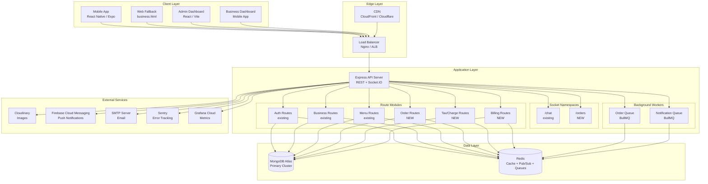
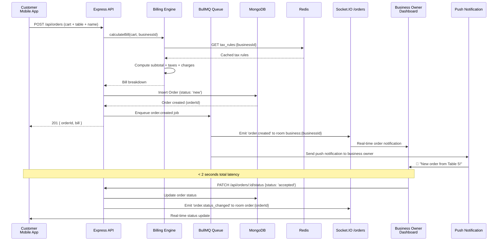
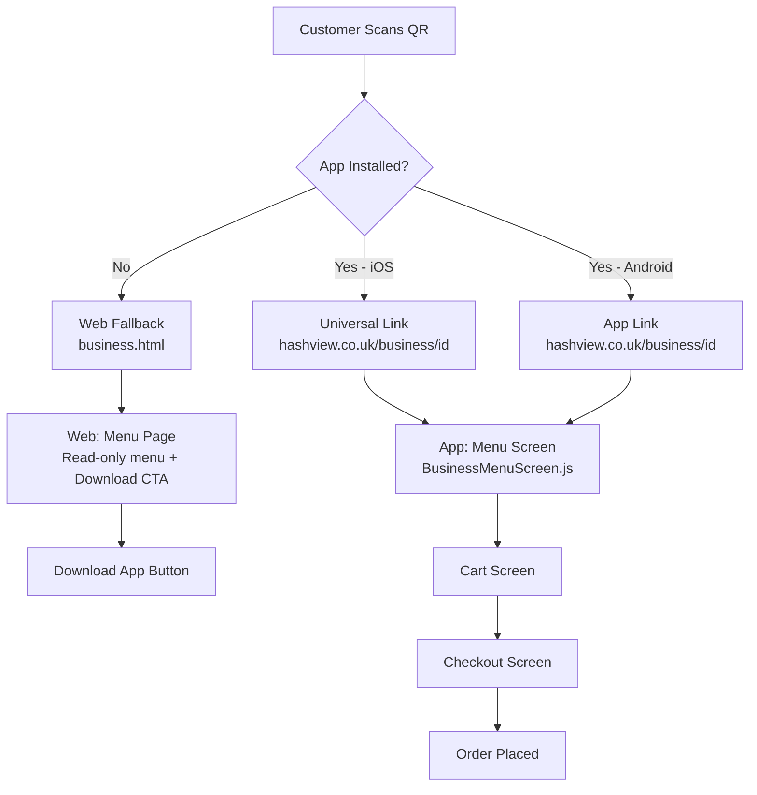
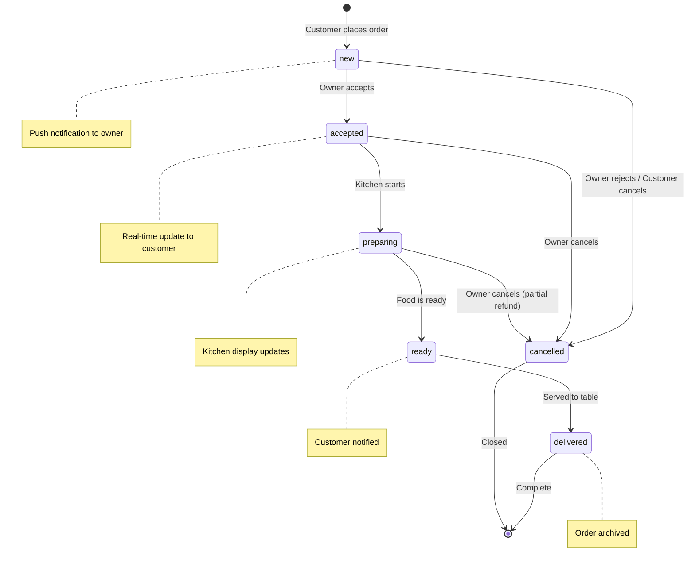
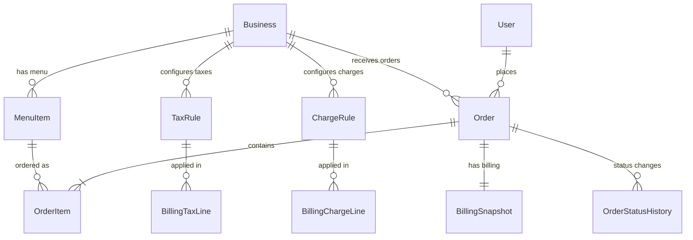
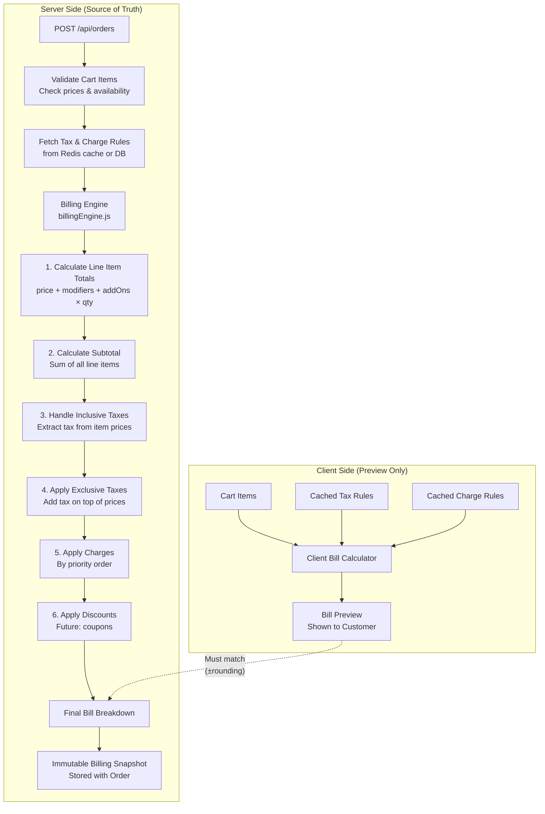
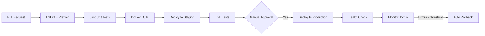
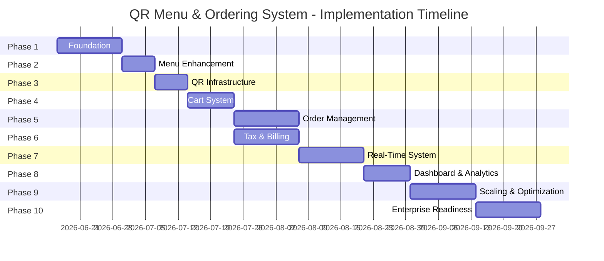

# HashView — QR Menu & Real-Time Restaurant Ordering System

## Software Architecture Document (SAD) & Implementation Roadmap

> **Version**: 1.0  
> **Date**: 2026-06-10  
> **Classification**: Enterprise Architecture — Implementation-Ready  
> **Target Audience**: Engineering Team, DevOps, Product Management

---

> [!CAUTION]
> ## § 0 — Zero Disruption Principle (Non-Negotiable)
> **This rule governs every single phase of this implementation without exception.**
>
> The entire implementation is **purely additive**. Nothing that currently works in production will be disrupted, altered, or compromised.
>
> ### What This Means in Practice
>
> | Rule | Detail |
> |---|---|
> | **New files only** | Every new feature lives in a new file: new model, new controller, new route, new socket, new screen |
> | **Existing routes are untouched** | No existing API endpoint changes its URL, method, request shape, or response shape |
> | **Existing models are only extended** | New fields are always optional with safe defaults — existing documents remain valid without migration |
> | **Existing sockets are untouched** | `chat.socket.js` is not modified. New ordering events live in a new `/orders` namespace |
> | **Existing screens are untouched** | No existing React Native screen is refactored or restructured to accommodate ordering |
> | **Existing Redux slices are untouched** | New `cartSlice` and `orderSlice` are added alongside existing slices, not merged into them |
> | **server.js changes are append-only** | New routes/workers are registered by adding new `app.use()` lines only — no existing line is modified |
> | **Existing indexes are untouched** | New MongoDB indexes are additive — no existing index is dropped or changed |
> | **Existing tests must stay green** | Every phase ends with a full existing test suite run; zero regressions allowed before proceeding |
> | **Backward-compatible DB changes only** | New fields added to existing models must have `default` values so existing documents are never invalidated |
>
> ### Pre-Phase Checklist (Run Before Starting Every Phase)
> - [ ] All existing API endpoints return the same responses as before
> - [ ] All existing mobile screens navigate and render correctly
> - [ ] All existing tests pass (`npm test` in `/backend`)
> - [ ] No existing environment variables are changed or removed
> - [ ] No existing Mongoose model loses a field or changes a field type
>
> **If any item on this checklist fails after a phase, the change is reverted before proceeding.**

---

# Table of Contents

1. [Executive Summary](#1-executive-summary)
2. [Existing Stack Analysis & Reuse Matrix](#2-existing-stack-analysis--reuse-matrix)
3. [High-Level Architecture](#3-high-level-architecture)
4. [Low-Level Module Architecture](#4-low-level-module-architecture)
5. [Database Design](#5-database-design)
6. [Tax, Charges & Billing Engine](#6-tax-charges--billing-engine)
7. [API Design](#7-api-design)
8. [Real-Time Event Architecture](#8-real-time-event-architecture)
9. [Security Design](#9-security-design)
10. [Scalability Design](#10-scalability-design)
11. [Reliability & Fault Tolerance](#11-reliability--fault-tolerance)
12. [Monitoring & Observability](#12-monitoring--observability)
13. [UX Design](#13-ux-design)
14. [Deployment Architecture](#14-deployment-architecture)
15. [Cost Optimization](#15-cost-optimization)
16. [10-Phase Implementation Roadmap](#16-10-phase-implementation-roadmap)
17. [Future Roadmap](#17-future-roadmap)

---

# 1. Executive Summary

This document defines the complete architecture and implementation plan for adding a **QR Menu & Real-Time Restaurant Ordering System** with a **multi-tenant Tax & Billing Engine** to the existing HashView platform.

### Key Design Decisions

| Decision | Choice | Rationale |
|---|---|---|
| Real-time transport | Socket.IO (existing) | Already in production for chat; proven WebSocket + fallback |
| Database | MongoDB (existing) | Schema-flexible for menu/order documents; already at scale |
| Cache | Redis (existing) | Already initialized; extend for menu caching + pub/sub |
| Message broker | Redis Pub/Sub → BullMQ | Zero new infra at startup; upgrade to RabbitMQ at 10K+ restaurants |
| Order queue | BullMQ (Redis-backed) | Reliable job processing with retry, DLQ, rate limiting |
| Architecture style | Modular monolith → extractable services | Avoid premature microservices; clear module boundaries allow extraction later |
| Mobile framework | React Native / Expo (existing) | Reuse 100% of existing mobile infrastructure |
| Payment integration | **None — Pay at counter** | Customer pays at the business's cash counter after food is served and consumed; no in-app payment processing needed |
| Delivery model | **Table-service only** | Food is delivered to tables within the restaurant; no home delivery / pickup / third-party delivery |
| QR strategy | Single QR per business | Customer enters table number manually; eliminates QR management complexity |
| Billing engine | Server-authoritative with client preview | Backend is source of truth; frontend shows preview only. Bill serves as the order summary — actual payment is collected at the counter |

### What Gets Reused vs. What's New

```
┌─────────────────────────────────────────────────────────┐
│                    REUSED (70%)                          │
├─────────────────────────────────────────────────────────┤
│ ✅ Express backend + server.js entry point              │
│ ✅ MongoDB + Mongoose ODM + connection pooling          │
│ ✅ Redis client + cache utilities                       │
│ ✅ Socket.IO infrastructure + JWT auth middleware        │
│ ✅ MenuItem model (8KB, 200 lines, fully indexed)       │
│ ✅ Business model (qrCode field already exists!)        │
│ ✅ Notification model + push notification system        │
│ ✅ JWT auth + protect/authorize middleware               │
│ ✅ Cloudinary upload pipeline                           │
│ ✅ Sentry error tracking                                │
│ ✅ Grafana metrics middleware                           │
│ ✅ React Native / Expo mobile app                       │
│ ✅ Redux store architecture                             │
│ ✅ QR deep link handler (business.html already exists)  │
│ ✅ Expo Barcode Scanner (already in dependencies)       │
├─────────────────────────────────────────────────────────┤
│                    NEW (30%)                             │
├─────────────────────────────────────────────────────────┤
│ 🆕 Order model + Order Status History model             │
│ 🆕 TaxRule model + ChargeRule model                     │
│ 🆕 Cart module (client-side + server validation)        │
│ 🆕 Order controller + routes                           │
│ 🆕 Tax/Charge controller + routes                      │
│ 🆕 Billing engine (server-side calculation)             │
│ 🆕 order.socket.js (real-time order events)             │
│ 🆕 BullMQ order processing queue                       │
│ 🆕 5 new mobile screens (Menu, Cart, Checkout, Track)   │
│ 🆕 3 new dashboard screens (Orders, Kitchen, Analytics) │
│ 🆕 Invoice generation service                          │
└─────────────────────────────────────────────────────────┘
```

---

# 2. Existing Stack Analysis & Reuse Matrix

## 2.1 Current Architecture Audit

Based on complete codebase analysis of the production HashView platform:

| Component | Technology | Status | Reuse for Ordering |
|---|---|---|---|
| **Backend** | Node.js + Express (server.js, 329 LOC) | ✅ Production | **100% reuse** — add new route modules |
| **Database** | MongoDB Atlas via Mongoose | ✅ Production | **100% reuse** — add new collections |
| **Cache** | Redis (config/redis.js, 136 LOC) | ✅ Production | **100% reuse** — extend for menu/order caching |
| **WebSockets** | Socket.IO (sockets/chat.socket.js) | ✅ Production | **80% reuse** — add order namespace |
| **Auth** | JWT + protect/authorize middleware | ✅ Production | **100% reuse** — orders use same auth |
| **Mobile** | React Native Expo (36 screens) | ✅ Production | **90% reuse** — add 8 new screens |
| **MenuItem Model** | 201 LOC, 7 indexes, AI meal classifier | ✅ Production | **95% reuse** — add add-ons/modifiers |
| **Business Model** | 286 LOC, `qrCode` field exists (L167) | ✅ Production | **100% reuse** — QR field ready |
| **QR Landing** | public/business.html (deep link handler) | ✅ Production | **Extend** — add menu redirect path |
| **Push Notifications** | Expo Push + FCM | ✅ Production | **100% reuse** — add order notification types |
| **File Upload** | Cloudinary (upload.controller.js) | ✅ Production | **100% reuse** — menu item images |
| **Monitoring** | Sentry + Grafana Prometheus metrics | ✅ Production | **100% reuse** — add order metrics |
| **State Management** | Redux Toolkit | ✅ Production | **90% reuse** — add cart/order slices |

## 2.2 Critical Discovery: Existing Assets

> [!IMPORTANT]
> The codebase already has significant ordering infrastructure:
> - `Business.model.js` line 167: `qrCode: { type: String, default: null }` — QR field **already exists**
> - `MenuItem.model.js` — 201-line production model with categories, pricing, availability, images, dietary info, AI classification, and 7 performance indexes
> - `menuItem.routes.js` — Full CRUD + AI extraction + batch create + reorder endpoints
> - `menuItem.controller.js` — 21KB controller with Cloudinary integration
> - `public/business.html` — Deep link landing page with iOS/Android detection already works
> - `chat.socket.js` — Proven Socket.IO pattern with JWT auth, rooms, online tracking

## 2.3 What Should Remain Monolithic vs. Separated

| Module | Decision | Reasoning |
|---|---|---|
| Menu Management | **Stay in monolith** | Already tightly coupled to Business model; shared DB queries |
| QR Module | **Stay in monolith** | Thin logic layer; just generates/validates codes |
| Order Processing | **Modular within monolith** | Own controller/model/socket but same Express process |
| Billing Engine | **Modular within monolith** | Shared by cart preview + order confirmation; needs same DB |
| Real-Time Events | **Modular within monolith** | Socket.IO namespace isolation within same server |
| Notification Dispatch | **Extract at 10K+ restaurants** | High-volume push + email; BullMQ handles load initially |
| Invoice Generation | **Extract at 10K+ restaurants** | CPU-intensive PDF gen; offload to worker process later |

> [!TIP]
> The modular monolith approach means every new module gets its own `models/`, `controllers/`, `routes/`, and `sockets/` files — maintaining the existing codebase structure. Extraction to a separate service requires only changing the transport layer (HTTP/gRPC instead of function calls), not rewriting business logic.

---

# 3. High-Level Architecture

## 3.1 System Architecture Diagram



## 3.2 Request Flow — Customer Places Order



## 3.3 Technology Justification

| Technology | Why Chosen | Alternative Considered | Why Not |
|---|---|---|---|
| **Socket.IO** | Already in production (chat.socket.js); automatic reconnection; room-based broadcasting; fallback to long-polling | Raw WebSockets / SSE | No fallback; no built-in rooms; would need custom reconnection logic |
| **BullMQ** | Redis-backed job queue; retries; DLQ; rate limiting; delayed jobs; dashboard (Bull Board) | RabbitMQ | Overkill for startup; requires separate broker process; BullMQ uses existing Redis |
| **Redis Pub/Sub** | Cross-process event broadcasting (when scaling to multiple API instances); already connected | Kafka | Massive overkill at this scale; operational complexity |
| **MongoDB** | Document model fits order/menu data perfectly; existing cluster; flexible schema for tax rules | PostgreSQL | Would require new infrastructure; lose Mongoose ecosystem; no benefit for this use case |
| **Modular Monolith** | Fast iteration; shared database; easy debugging; defer complexity | Microservices from day 1 | Premature; doubles deployment complexity; network overhead; eventual consistency headaches |

---

# 4. Low-Level Module Architecture

## 4.1 Menu Management Module

> **Status**: 80% already built. Extend existing `MenuItem.model.js`.
>
> **§0 Compliance**: All new fields (`modifiers`, `addOns`, `prepTime`, `allergens`, `calories`) are **optional with safe defaults**. Existing menu items without these fields continue to work exactly as before. The existing 7 indexes are untouched. All existing CRUD endpoints retain their current request/response shape — new fields are simply ignored by old clients.

### 4.1.1 Existing Capabilities (No Changes Needed)

- ✅ Menu item CRUD with Cloudinary image upload
- ✅ `menuCategory` field for grouping (Starters, Mains, etc.)
- ✅ `price`, `currency`, `isAvailable`, `availableDays`, `availableTimeSlots`
- ✅ `dietary` labels (vegan, halal, gluten-free, etc.)
- ✅ `isPopular`, `isFeatured`, `sortOrder` display controls
- ✅ `tags` for search + AI classification
- ✅ Full-text search index with weighted fields
- ✅ AI menu extraction from photos
- ✅ Batch create + reorder endpoints

### 4.1.2 New Fields to Add to MenuItem Model

```javascript
// Add to existing menuItemSchema:

// ─── Ordering-Specific Fields ─────────────────────────────────────────
modifiers: [{
  name: { type: String, required: true },      // "Size", "Spice Level"
  required: { type: Boolean, default: false },
  maxSelections: { type: Number, default: 1 },
  options: [{
    name: { type: String, required: true },     // "Small", "Medium", "Large"
    priceAdjustment: { type: Number, default: 0 }, // +£2.00
    isDefault: { type: Boolean, default: false }
  }]
}],

addOns: [{
  name: { type: String, required: true },       // "Extra Cheese", "Bacon"
  price: { type: Number, required: true },      // £1.50
  isAvailable: { type: Boolean, default: true },
  maxQuantity: { type: Number, default: 5 }
}],

// Preparation time in minutes (for kitchen display)
prepTime: {
  type: Number,
  default: 15,
  min: 1,
  max: 120
},

// Maximum orders per time slot (prevent overselling)
maxOrdersPerSlot: {
  type: Number,
  default: null  // null = unlimited
},

// Allergen information (mandatory in UK/EU)
allergens: {
  type: [String],
  enum: ['celery', 'gluten', 'crustaceans', 'eggs', 'fish', 'lupin',
         'milk', 'molluscs', 'mustard', 'nuts', 'peanuts', 'sesame',
         'soybeans', 'sulphites'],
  default: []
},

// Calorie count (optional, UK regulations)
calories: {
  type: Number,
  default: null
}
```

### 4.1.3 Module File Structure

```
backend/
├── models/
│   └── MenuItem.model.js          # MODIFY — add modifiers, addOns, prepTime
├── controllers/
│   └── menuItem.controller.js     # MODIFY — add public menu endpoint optimizations
├── routes/
│   └── menuItem.routes.js         # MODIFY — add ordering-optimized public endpoint
```

---

## 4.2 QR Module

### 4.2.1 QR Strategy

```
┌────────────────────────────────────────────┐
│           ONE QR per Business               │
│                                            │
│  QR Content: https://api.hashview.co.uk    │
│              /business/{businessId}         │
│                                            │
│  Same QR on EVERY table                    │
│  Customer enters table number at checkout   │
│                                            │
│  Scan Paths:                               │
│  ┌──────────────────────────────────────┐  │
│  │ HashView App Installed?              │  │
│  │   YES → Deep link to menu screen    │  │
│  │   NO  → Web fallback (business.html)│  │
│  │         → Shows menu + app download │  │
│  └──────────────────────────────────────┘  │
└────────────────────────────────────────────┘
```

### 4.2.2 Deep Link Flow



### 4.2.3 QR Generation

```javascript
// QR generation on business registration/activation
// Uses existing Business.model.js qrCode field (line 167)

const QRCode = require('qrcode');

const generateBusinessQR = async (businessId) => {
  const qrUrl = `https://api.hashview.co.uk/business/${businessId}`;
  
  // Generate QR as data URL for storage/display
  const qrDataUrl = await QRCode.toDataURL(qrUrl, {
    width: 1024,
    margin: 2,
    color: {
      dark: '#210059',    // HashView brand purple
      light: '#FFFFFF'
    },
    errorCorrectionLevel: 'H'  // High — survives 30% damage
  });
  
  // Upload to Cloudinary for CDN delivery
  const uploaded = await cloudinary.uploader.upload(qrDataUrl, {
    folder: 'hashview/qr-codes',
    public_id: `business_${businessId}`,
    overwrite: true
  });
  
  // Store URL in existing Business.qrCode field
  await Business.findByIdAndUpdate(businessId, {
    qrCode: uploaded.secure_url
  });
  
  return uploaded.secure_url;
};
```

### 4.2.4 Updated business.html (Web Fallback)

The existing `public/business.html` already handles deep linking. Extend it to show:
1. Business name + logo (fetched via API)
2. Read-only menu (for non-app users)
3. "Order via App" call-to-action
4. App Store / Play Store download buttons (already present)

---

## 4.3 Cart Module

### 4.3.1 Cart Architecture

```
┌─────────────────────────────────────────────────┐
│                  CART MODULE                     │
│                                                 │
│  Storage: Client-side (Redux + AsyncStorage)    │
│  Validation: Server-side on checkout            │
│                                                 │
│  ┌───────────────────────────────────────────┐  │
│  │ Why Client-Side Cart?                     │  │
│  │                                           │  │
│  │ • No login required to browse/add items   │  │
│  │ • Works offline                           │  │
│  │ • Zero server load for cart operations    │  │
│  │ • Server validates ONLY on checkout       │  │
│  │ • Billing preview calculated client-side  │  │
│  │   (with server-authoritative final calc)  │  │
│  └───────────────────────────────────────────┘  │
│                                                 │
│  Cart Lifecycle:                                │
│  1. User scans QR → lands on menu              │
│  2. Adds items to client cart (Redux)           │
│  3. Cart persisted in AsyncStorage              │
│  4. On checkout → sends cart to server          │
│  5. Server validates prices, availability       │
│  6. Billing engine calculates final total       │
│  7. Order created with immutable billing snap   │
│  8. Cart cleared on success                     │
└─────────────────────────────────────────────────┘
```

### 4.3.2 Redux Cart Slice

```javascript
// frontend/src/store/slices/cartSlice.js

const cartSlice = createSlice({
  name: 'cart',
  initialState: {
    businessId: null,
    businessName: '',
    items: [],           // [{ menuItemId, name, price, quantity, modifiers, addOns, notes }]
    tableNumber: '',
    customerName: '',
    numberOfPeople: 1,
    orderNotes: '',
    billPreview: null,   // Client-calculated preview
  },
  reducers: {
    setBusinessContext(state, action) { /* ... */ },
    addItem(state, action) { /* ... */ },
    updateQuantity(state, action) { /* ... */ },
    removeItem(state, action) { /* ... */ },
    updateModifiers(state, action) { /* ... */ },
    setTableNumber(state, action) { /* ... */ },
    setCustomerName(state, action) { /* ... */ },
    setNumberOfPeople(state, action) { /* ... */ },
    setOrderNotes(state, action) { /* ... */ },
    setBillPreview(state, action) { /* ... */ },
    clearCart(state) { /* reset to initial */ },
  }
});
```

### 4.3.3 Cart Validation Rules

| Rule | Enforcement |
|---|---|
| Cart cannot mix items from different businesses | Client-side (warn + block) |
| Item must be available (`isAvailable: true`) | Server-side on checkout |
| Item price must match current price | Server-side on checkout |
| Required modifiers must be selected | Client-side + server-side |
| Quantity > 0 and ≤ 99 | Client-side + server-side |
| `maxOrdersPerSlot` not exceeded | Server-side on checkout |
| Table number required | Client-side + server-side |
| Customer name required | Client-side + server-side |

---

## 4.4 Order Module

### 4.4.1 Order Lifecycle State Machine



### 4.4.2 Status Transition Rules

```javascript
const VALID_TRANSITIONS = {
  'new':       ['accepted', 'cancelled'],
  'accepted':  ['preparing', 'cancelled'],
  'preparing': ['ready', 'cancelled'],
  'ready':     ['delivered'],
  'delivered': [],  // terminal state
  'cancelled': [],  // terminal state
};

// Only business owner or admin can change status
// Customer can only cancel when status === 'new'
```

---

## 4.5 Real-Time Module

### 4.5.1 Socket.IO Namespace Architecture

```javascript
// backend/sockets/order.socket.js

module.exports = (io) => {
  const orderNamespace = io.of('/orders');
  
  // Reuse same JWT auth middleware as chat.socket.js
  orderNamespace.use(jwtSocketAuth);
  
  orderNamespace.on('connection', (socket) => {
    
    // Business owner joins their business room
    socket.on('join_business', ({ businessId }) => {
      socket.join(`business:${businessId}`);
    });
    
    // Customer joins their order room
    socket.on('join_order', ({ orderId }) => {
      socket.join(`order:${orderId}`);
    });
    
    // Customer joins business room to see menu availability changes
    socket.on('join_menu', ({ businessId }) => {
      socket.join(`menu:${businessId}`);
    });
  });
  
  return orderNamespace;
};
```

### 4.5.2 Room Architecture

```
Socket.IO Rooms:
├── business:{businessId}     ← Owner dashboard listens here
│   ├── order.created         → New order notification
│   ├── order.cancelled       → Customer cancelled
│   └── business.stats        → Live order count, revenue
│
├── order:{orderId}           ← Customer listens here
│   ├── order.status_changed  → Status: accepted/preparing/ready/delivered
│   └── order.cancelled       → Order was cancelled by owner
│
└── menu:{businessId}         ← All customers viewing this menu
    ├── menu.item_unavailable → Item went out of stock
    └── menu.item_updated     → Price/availability change
```

---

# 5. Database Design

## 5.1 Entity Relationship Diagram



## 5.2 Collections

### 5.2.1 `orders` Collection

```javascript
// backend/models/Order.model.js

const orderSchema = new mongoose.Schema({
  // ─── References ──────────────────────────────────────────
  business: {
    type: mongoose.Schema.Types.ObjectId,
    ref: 'Business',
    required: true,
    index: true
  },
  customer: {
    type: mongoose.Schema.Types.ObjectId,
    ref: 'User',
    default: null            // null for guest orders
  },
  
  // ─── Order Identification ────────────────────────────────
  orderNumber: {
    type: String,
    required: true,
    unique: true             // Human-readable: "HV-ABC123-0042"
  },
  
  // ─── Customer Info ───────────────────────────────────────
  customerName: {
    type: String,
    required: true,
    trim: true,
    maxlength: 100
  },
  tableNumber: {
    type: String,
    required: true,
    trim: true,
    maxlength: 20
  },
  numberOfPeople: {
    type: Number,
    required: true,
    min: 1,
    max: 50,
    default: 1
  },
  
  // ─── Order Items (Denormalized Snapshot) ──────────────────
  items: [{
    menuItem: {
      type: mongoose.Schema.Types.ObjectId,
      ref: 'MenuItem'
    },
    name: String,                    // Snapshot at order time
    price: Number,                   // Snapshot at order time
    currency: String,
    quantity: { type: Number, min: 1 },
    modifiers: [{
      name: String,
      selectedOption: String,
      priceAdjustment: Number
    }],
    addOns: [{
      name: String,
      price: Number,
      quantity: Number
    }],
    itemNotes: String,
    itemTotal: Number                // (price + modifiers + addOns) × quantity
  }],
  
  // ─── Billing Snapshot (Immutable) ─────────────────────────
  billing: {
    subtotal: { type: Number, required: true },
    taxes: [{
      taxRuleId: mongoose.Schema.Types.ObjectId,
      name: String,                  // "GST", "VAT"
      type: String,                  // "percentage" | "fixed"
      rate: Number,                  // 18 (for 18%) or 20 (for ₹20)
      calculationMode: String,      // "inclusive" | "exclusive"
      applicability: String,         // "entire_order" | "category" | "item"
      amount: Number                 // Calculated tax amount
    }],
    charges: [{
      chargeRuleId: mongoose.Schema.Types.ObjectId,
      name: String,                  // "Service Charge"
      type: String,                  // "percentage" | "fixed"
      rate: Number,
      amount: Number                 // Calculated charge amount
    }],
    totalTax: { type: Number, default: 0 },
    totalCharges: { type: Number, default: 0 },
    discount: { type: Number, default: 0 },    // Future: coupons
    grandTotal: { type: Number, required: true }
  },
  
  // ─── Status ──────────────────────────────────────────────
  status: {
    type: String,
    enum: ['new', 'accepted', 'preparing', 'ready', 'delivered', 'cancelled'],
    default: 'new',
    index: true
  },
  cancelReason: String,
  cancelledBy: {
    type: String,
    enum: ['customer', 'business', 'system'],
    default: null
  },
  
  // ─── Notes ───────────────────────────────────────────────
  orderNotes: {
    type: String,
    maxlength: 500
  },
  
  // ─── Timestamps ──────────────────────────────────────────
  placedAt: { type: Date, default: Date.now },
  acceptedAt: Date,
  preparingAt: Date,
  readyAt: Date,
  deliveredAt: Date,
  cancelledAt: Date,
  
  // ─── Invoice ─────────────────────────────────────────────
  invoiceNumber: String,         // "INV-2026-00042"
  invoiceGenerated: { type: Boolean, default: false }

}, {
  timestamps: true
});

// ─── Indexes ──────────────────────────────────────────────
orderSchema.index({ business: 1, status: 1, createdAt: -1 });    // Dashboard: active orders
orderSchema.index({ business: 1, createdAt: -1 });                // Dashboard: order history
orderSchema.index({ customer: 1, createdAt: -1 });                // Customer: my orders
orderSchema.index({ orderNumber: 1 }, { unique: true });          // Lookup by order number
orderSchema.index({ business: 1, tableNumber: 1, status: 1 });   // Kitchen: orders by table
orderSchema.index({ status: 1, createdAt: 1 });                   // Admin: system-wide monitoring
```

### 5.2.2 `orderstatushistories` Collection

```javascript
// backend/models/OrderStatusHistory.model.js

const orderStatusHistorySchema = new mongoose.Schema({
  order: {
    type: mongoose.Schema.Types.ObjectId,
    ref: 'Order',
    required: true,
    index: true
  },
  fromStatus: {
    type: String,
    enum: ['new', 'accepted', 'preparing', 'ready', 'delivered', 'cancelled']
  },
  toStatus: {
    type: String,
    enum: ['new', 'accepted', 'preparing', 'ready', 'delivered', 'cancelled'],
    required: true
  },
  changedBy: {
    type: mongoose.Schema.Types.ObjectId,
    ref: 'User',
    required: true
  },
  changedByRole: {
    type: String,
    enum: ['customer', 'business', 'admin']
  },
  notes: String,
  timestamp: { type: Date, default: Date.now }
}, {
  timestamps: false
});

orderStatusHistorySchema.index({ order: 1, timestamp: 1 });
```

### 5.2.3 `taxrules` Collection

```javascript
// backend/models/TaxRule.model.js

const taxRuleSchema = new mongoose.Schema({
  business: {
    type: mongoose.Schema.Types.ObjectId,
    ref: 'Business',
    required: true,
    index: true
  },
  
  // ─── Tax Identity ──────────────────────────────────────
  name: {
    type: String,
    required: true,
    trim: true,
    maxlength: 100
    // Examples: "GST", "VAT", "CGST", "SGST", "Service Tax", "Sales Tax"
  },
  
  // ─── Tax Configuration ────────────────────────────────
  taxType: {
    type: String,
    enum: ['percentage', 'fixed'],
    required: true
  },
  rate: {
    type: Number,
    required: true,
    min: 0
    // For percentage: 18 means 18%
    // For fixed: 20 means ₹20 / £20
  },
  
  // ─── Calculation Mode ─────────────────────────────────
  calculationMode: {
    type: String,
    enum: ['inclusive', 'exclusive'],
    default: 'exclusive'
    // inclusive: tax is included in item price (customer sees ₹100)
    // exclusive: tax is added on top (customer sees ₹100 + ₹18 tax)
  },
  
  // ─── Applicability ────────────────────────────────────
  applicability: {
    type: String,
    enum: ['entire_order', 'category', 'item'],
    default: 'entire_order'
  },
  // When applicability = 'category', list of menuCategory names
  applicableCategories: [{
    type: String,
    trim: true
  }],
  // When applicability = 'item', list of specific MenuItem IDs
  applicableItems: [{
    type: mongoose.Schema.Types.ObjectId,
    ref: 'MenuItem'
  }],
  
  // ─── Priority & Status ────────────────────────────────
  priority: {
    type: Number,
    default: 0          // Lower number = applied first
  },
  isActive: {
    type: Boolean,
    default: true
  }
}, {
  timestamps: true
});

taxRuleSchema.index({ business: 1, isActive: 1, priority: 1 });
```

### 5.2.4 `chargerules` Collection

```javascript
// backend/models/ChargeRule.model.js

const chargeRuleSchema = new mongoose.Schema({
  business: {
    type: mongoose.Schema.Types.ObjectId,
    ref: 'Business',
    required: true,
    index: true
  },
  
  name: {
    type: String,
    required: true,
    trim: true,
    maxlength: 100
    // Examples: "Service Charge", "Packaging", "Cover Charge"
  },
  
  chargeType: {
    type: String,
    enum: ['percentage', 'fixed'],
    required: true
  },
  rate: {
    type: Number,
    required: true,
    min: 0
  },
  
  // ─── Applicability ────────────────────────────────────
  applicability: {
    type: String,
    enum: ['entire_order', 'category', 'item', 'conditional'],
    default: 'entire_order'
  },
  applicableCategories: [{ type: String }],
  applicableItems: [{ type: mongoose.Schema.Types.ObjectId, ref: 'MenuItem' }],
  
  // ─── Conditional Logic (future-ready) ─────────────────
  condition: {
    type: {
      type: String,
      enum: ['min_order_value', 'min_items', 'time_range', 'none'],
      default: 'none'
    },
    value: mongoose.Schema.Types.Mixed
    // min_order_value: 500 (apply only if subtotal >= 500)
    // min_items: 3 (apply only if items >= 3)
    // time_range: { start: "18:00", end: "22:00" }
  },
  
  priority: {
    type: Number,
    default: 0
  },
  isActive: {
    type: Boolean,
    default: true
  }
}, {
  timestamps: true
});

chargeRuleSchema.index({ business: 1, isActive: 1, priority: 1 });
```

### 5.2.5 Collection Summary Table

| Collection | Est. Doc Size | Growth Rate | Indexing Strategy | Sharding Key (future) |
|---|---|---|---|---|
| `orders` | 2–5 KB | High (100K+/month at scale) | Compound: `{business, status, createdAt}` | `business` (range) |
| `orderstatushistories` | 200 B | Very High (5x orders) | `{order, timestamp}` | `order` (hash) |
| `menuitems` | 1–3 KB | Low (changes are edits) | Existing 7 indexes are sufficient | `business` (range) |
| `taxrules` | 500 B | Very Low | `{business, isActive}` | Not needed |
| `chargerules` | 500 B | Very Low | `{business, isActive}` | Not needed |
| `businesses` | 3–5 KB | Low | Existing indexes sufficient | `_id` (hash) |
| `users` | 1–2 KB | Medium | Existing indexes sufficient | `_id` (hash) |
| `notifications` | 500 B | High | Existing indexes + add `{type, business}` | `sentTo` (hash) |

---

# 6. Tax, Charges & Billing Engine

## 6.1 Billing Engine Architecture



## 6.2 Billing Engine Implementation

```javascript
// backend/services/billingEngine.js

class BillingEngine {
  
  /**
   * Calculate complete bill for an order
   * @param {Array} cartItems - Validated cart items with current prices
   * @param {Array} taxRules - Active tax rules for this business
   * @param {Array} chargeRules - Active charge rules for this business
   * @returns {Object} Complete billing breakdown
   */
  static calculate(cartItems, taxRules, chargeRules) {
    // Step 1: Calculate line item totals
    const lineItems = cartItems.map(item => {
      const modifierTotal = (item.modifiers || [])
        .reduce((sum, m) => sum + (m.priceAdjustment || 0), 0);
      const addOnTotal = (item.addOns || [])
        .reduce((sum, a) => sum + (a.price * (a.quantity || 1)), 0);
      const itemTotal = (item.price + modifierTotal + addOnTotal) * item.quantity;
      
      return { ...item, modifierTotal, addOnTotal, itemTotal };
    });
    
    // Step 2: Calculate subtotal
    const subtotal = lineItems.reduce((sum, item) => sum + item.itemTotal, 0);
    
    // Step 3 & 4: Calculate taxes
    const taxLines = [];
    let totalTax = 0;
    
    const sortedTaxRules = [...taxRules]
      .filter(r => r.isActive)
      .sort((a, b) => a.priority - b.priority);
    
    for (const rule of sortedTaxRules) {
      const taxableAmount = this._getTaxableAmount(rule, lineItems, subtotal);
      let taxAmount = 0;
      
      if (rule.taxType === 'percentage') {
        if (rule.calculationMode === 'inclusive') {
          // Extract tax from price: tax = price - (price / (1 + rate/100))
          taxAmount = taxableAmount - (taxableAmount / (1 + rule.rate / 100));
        } else {
          // Add tax on top: tax = price * rate/100
          taxAmount = taxableAmount * (rule.rate / 100);
        }
      } else {
        // Fixed amount tax
        taxAmount = rule.rate;
      }
      
      taxAmount = Math.round(taxAmount * 100) / 100;  // Round to 2 decimals
      totalTax += taxAmount;
      
      taxLines.push({
        taxRuleId: rule._id,
        name: rule.name,
        type: rule.taxType,
        rate: rule.rate,
        calculationMode: rule.calculationMode,
        applicability: rule.applicability,
        amount: taxAmount
      });
    }
    
    // Step 5: Calculate charges
    const chargeLines = [];
    let totalCharges = 0;
    
    const sortedChargeRules = [...chargeRules]
      .filter(r => r.isActive)
      .sort((a, b) => a.priority - b.priority);
    
    for (const rule of sortedChargeRules) {
      if (!this._evaluateCondition(rule.condition, subtotal, lineItems)) continue;
      
      const chargeableAmount = this._getChargeableAmount(rule, lineItems, subtotal);
      let chargeAmount = 0;
      
      if (rule.chargeType === 'percentage') {
        chargeAmount = chargeableAmount * (rule.rate / 100);
      } else {
        chargeAmount = rule.rate;
      }
      
      chargeAmount = Math.round(chargeAmount * 100) / 100;
      totalCharges += chargeAmount;
      
      chargeLines.push({
        chargeRuleId: rule._id,
        name: rule.name,
        type: rule.chargeType,
        rate: rule.rate,
        amount: chargeAmount
      });
    }
    
    // Step 6: Calculate grand total
    const grandTotal = Math.round(
      (subtotal + totalTax + totalCharges) * 100
    ) / 100;
    
    return {
      subtotal,
      taxes: taxLines,
      charges: chargeLines,
      totalTax,
      totalCharges,
      discount: 0,          // Future: coupons/promos
      grandTotal
    };
  }
  
  // Determine taxable amount based on applicability scope
  static _getTaxableAmount(rule, lineItems, subtotal) {
    switch (rule.applicability) {
      case 'entire_order':
        return subtotal;
      case 'category':
        return lineItems
          .filter(i => rule.applicableCategories.includes(i.menuCategory))
          .reduce((sum, i) => sum + i.itemTotal, 0);
      case 'item':
        return lineItems
          .filter(i => rule.applicableItems.map(String).includes(String(i.menuItemId)))
          .reduce((sum, i) => sum + i.itemTotal, 0);
      default:
        return subtotal;
    }
  }
  
  // Evaluate conditional charge rules
  static _evaluateCondition(condition, subtotal, lineItems) {
    if (!condition || condition.type === 'none') return true;
    
    switch (condition.type) {
      case 'min_order_value':
        return subtotal >= condition.value;
      case 'min_items':
        return lineItems.reduce((sum, i) => sum + i.quantity, 0) >= condition.value;
      case 'time_range': {
        const now = new Date();
        const hours = `${now.getHours()}:${String(now.getMinutes()).padStart(2, '0')}`;
        return hours >= condition.value.start && hours <= condition.value.end;
      }
      default:
        return true;
    }
  }
}
```

## 6.3 Billing Consistency Guarantee

```
┌───────────────────────────────────────────────────┐
│           BILLING CONSISTENCY RULES               │
│                                                   │
│  1. Frontend previews are NEVER authoritative     │
│  2. Server recalculates on EVERY checkout         │
│  3. If server total differs from preview by > 1%  │
│     → Return 409 Conflict with new breakdown      │
│     → Customer must re-confirm                    │
│  4. Order stores IMMUTABLE billing snapshot        │
│  5. Changing tax rules NEVER affects past orders  │
│  6. All amounts rounded to 2 decimal places       │
│  7. Rounding applied AFTER all calculations       │
└───────────────────────────────────────────────────┘
```

## 6.4 Invoice Design

```javascript
// Invoice data structure (stored with order, PDF generated on demand)

const invoiceSchema = {
  invoiceNumber: "INV-2026-00042",
  orderNumber: "HV-ABC123-0042",
  
  business: {
    name: "Restaurant ABC",
    address: "123 High Street, London, W1A 1AA",
    phone: "+44 20 1234 5678",
    taxId: "GB123456789"           // VAT/GST registration number
  },
  
  customer: {
    name: "John Smith",
    tableNumber: "5",
    numberOfPeople: 3
  },
  
  items: [
    { name: "Chicken Tikka Masala", qty: 2, price: 12.99, total: 25.98 },
    { name: "Garlic Naan", qty: 3, price: 2.99, total: 8.97 },
    { name: "Mango Lassi", qty: 2, price: 3.49, total: 6.98 }
  ],
  
  billing: {
    subtotal: 41.93,
    taxes: [
      { name: "VAT (20%)", amount: 8.39 }
    ],
    charges: [
      { name: "Service Charge (10%)", amount: 4.19 }
    ],
    grandTotal: 54.51
  },
  
  timestamp: "2026-06-10T19:45:00Z"
};
```

---

# 7. API Design

## 7.1 Order APIs

### `POST /api/orders` — Place Order

```http
POST /api/orders
Authorization: Bearer <jwt_token>    (optional for guest orders)
Content-Type: application/json

{
  "businessId": "665a1b2c3d4e5f6789012345",
  "customerName": "John Smith",
  "tableNumber": "5",
  "numberOfPeople": 3,
  "orderNotes": "No peanuts please, severe allergy",
  "items": [
    {
      "menuItemId": "665a1b2c3d4e5f6789012346",
      "quantity": 2,
      "modifiers": [
        { "name": "Spice Level", "selectedOption": "Medium", "priceAdjustment": 0 }
      ],
      "addOns": [
        { "name": "Extra Cheese", "price": 1.50, "quantity": 1 }
      ],
      "itemNotes": "Well done"
    },
    {
      "menuItemId": "665a1b2c3d4e5f6789012347",
      "quantity": 3,
      "modifiers": [],
      "addOns": [],
      "itemNotes": ""
    }
  ]
}
```

**Response (201 Created):**

```json
{
  "success": true,
  "data": {
    "orderId": "665b2c3d4e5f67890123456a",
    "orderNumber": "HV-ABC123-0042",
    "status": "new",
    "billing": {
      "subtotal": 41.93,
      "taxes": [
        { "name": "VAT (20%)", "type": "percentage", "rate": 20, "amount": 8.39 }
      ],
      "charges": [
        { "name": "Service Charge", "type": "percentage", "rate": 10, "amount": 4.19 }
      ],
      "totalTax": 8.39,
      "totalCharges": 4.19,
      "discount": 0,
      "grandTotal": 54.51
    },
    "placedAt": "2026-06-10T19:45:00.000Z",
    "estimatedPrepTime": 25
  }
}
```

**Error Response (422 Unprocessable Entity):**

```json
{
  "success": false,
  "message": "Some items are no longer available",
  "errors": [
    {
      "menuItemId": "665a1b2c3d4e5f6789012346",
      "issue": "PRICE_CHANGED",
      "currentPrice": 13.99,
      "yourPrice": 12.99
    },
    {
      "menuItemId": "665a1b2c3d4e5f6789012348",
      "issue": "UNAVAILABLE"
    }
  ]
}
```

---

### `GET /api/orders/:id` — Get Order Details

```http
GET /api/orders/665b2c3d4e5f67890123456a
Authorization: Bearer <jwt_token>
```

**Response (200 OK):**

```json
{
  "success": true,
  "data": {
    "orderId": "665b2c3d4e5f67890123456a",
    "orderNumber": "HV-ABC123-0042",
    "business": {
      "_id": "665a1b2c3d4e5f6789012345",
      "name": "Restaurant ABC",
      "logo": { "url": "https://res.cloudinary.com/..." }
    },
    "customerName": "John Smith",
    "tableNumber": "5",
    "numberOfPeople": 3,
    "status": "preparing",
    "items": [
      {
        "name": "Chicken Tikka Masala",
        "price": 12.99,
        "quantity": 2,
        "modifiers": [{ "name": "Spice Level", "selectedOption": "Medium" }],
        "addOns": [{ "name": "Extra Cheese", "price": 1.50, "quantity": 1 }],
        "itemTotal": 28.98
      }
    ],
    "billing": {
      "subtotal": 41.93,
      "taxes": [{ "name": "VAT (20%)", "amount": 8.39 }],
      "charges": [{ "name": "Service Charge (10%)", "amount": 4.19 }],
      "grandTotal": 54.51
    },
    "orderNotes": "No peanuts please, severe allergy",
    "placedAt": "2026-06-10T19:45:00.000Z",
    "acceptedAt": "2026-06-10T19:45:45.000Z",
    "preparingAt": "2026-06-10T19:46:30.000Z"
  }
}
```

---

### `PATCH /api/orders/:id/status` — Update Order Status

```http
PATCH /api/orders/665b2c3d4e5f67890123456a/status
Authorization: Bearer <jwt_token>
Content-Type: application/json

{
  "status": "accepted",
  "notes": "Estimated 20 minutes"
}
```

**Response (200 OK):**

```json
{
  "success": true,
  "data": {
    "orderId": "665b2c3d4e5f67890123456a",
    "previousStatus": "new",
    "currentStatus": "accepted",
    "updatedAt": "2026-06-10T19:45:45.000Z"
  }
}
```

---

### `GET /api/orders/business/:businessId` — Business Order Dashboard

```http
GET /api/orders/business/665a1b2c3d4e5f6789012345?status=new,accepted,preparing&limit=50
Authorization: Bearer <jwt_token>
```

---

### `POST /api/orders/:id/cancel` — Cancel Order

```http
POST /api/orders/665b2c3d4e5f67890123456a/cancel
Authorization: Bearer <jwt_token>
Content-Type: application/json

{
  "reason": "Wait time too long"
}
```

---

## 7.2 Tax & Charge Management APIs

### `POST /api/tax-rules` — Create Tax Rule

```http
POST /api/tax-rules
Authorization: Bearer <jwt_token>
Content-Type: application/json

{
  "name": "GST",
  "taxType": "percentage",
  "rate": 18,
  "calculationMode": "exclusive",
  "applicability": "entire_order",
  "priority": 1
}
```

**Response (201 Created):**

```json
{
  "success": true,
  "data": {
    "_id": "665c1234...",
    "business": "665a1b2c...",
    "name": "GST",
    "taxType": "percentage",
    "rate": 18,
    "calculationMode": "exclusive",
    "applicability": "entire_order",
    "priority": 1,
    "isActive": true
  }
}
```

### `GET /api/tax-rules/business/:businessId` — List Tax Rules
### `PUT /api/tax-rules/:id` — Update Tax Rule
### `DELETE /api/tax-rules/:id` — Delete Tax Rule
### `PATCH /api/tax-rules/:id/toggle` — Enable/Disable Tax Rule

### `POST /api/charge-rules` — Create Charge Rule

```http
POST /api/charge-rules
Authorization: Bearer <jwt_token>

{
  "name": "Service Charge",
  "chargeType": "percentage",
  "rate": 10,
  "applicability": "entire_order",
  "condition": {
    "type": "min_order_value",
    "value": 200
  }
}
```

### `GET /api/charge-rules/business/:businessId` — List Charge Rules
### `PUT /api/charge-rules/:id` — Update Charge Rule
### `DELETE /api/charge-rules/:id` — Delete Charge Rule
### `PATCH /api/charge-rules/:id/toggle` — Enable/Disable Charge Rule

---

### `POST /api/billing/preview` — Preview Bill (Checkout)

```http
POST /api/billing/preview
Content-Type: application/json

{
  "businessId": "665a1b2c3d4e5f6789012345",
  "items": [
    { "menuItemId": "...", "quantity": 2 },
    { "menuItemId": "...", "quantity": 1 }
  ]
}
```

**Response (200 OK):**

```json
{
  "success": true,
  "data": {
    "subtotal": 500.00,
    "taxes": [
      { "name": "GST (18%)", "amount": 90.00 }
    ],
    "charges": [
      { "name": "Service Charge (5%)", "amount": 25.00 }
    ],
    "grandTotal": 615.00,
    "breakdown": "Subtotal ₹500 + GST ₹90 + Service ₹25 = ₹615"
  }
}
```

---

### `GET /api/orders/:id/invoice` — Generate Invoice

```http
GET /api/orders/665b2c3d4e5f67890123456a/invoice
Authorization: Bearer <jwt_token>
Accept: application/json          // Returns JSON invoice data
# or
Accept: application/pdf           // Future: Returns PDF
```

---

## 7.3 Complete API Endpoint Summary

| Method | Endpoint | Auth | Role | Purpose |
|---|---|---|---|---|
| **Order Management** |||||
| `POST` | `/api/orders` | Optional | any | Place order |
| `GET` | `/api/orders/:id` | Required | owner/customer | Get order details |
| `GET` | `/api/orders/business/:businessId` | Required | business/admin | List business orders |
| `GET` | `/api/orders/my-orders` | Required | user | Customer order history |
| `PATCH` | `/api/orders/:id/status` | Required | business/admin | Update order status |
| `POST` | `/api/orders/:id/cancel` | Required | business/customer | Cancel order |
| `GET` | `/api/orders/:id/invoice` | Required | business/customer | Get invoice |
| **Tax Management** |||||
| `POST` | `/api/tax-rules` | Required | business/admin | Create tax rule |
| `GET` | `/api/tax-rules/business/:businessId` | Required | business/admin | List tax rules |
| `PUT` | `/api/tax-rules/:id` | Required | business/admin | Update tax rule |
| `DELETE` | `/api/tax-rules/:id` | Required | business/admin | Delete tax rule |
| `PATCH` | `/api/tax-rules/:id/toggle` | Required | business/admin | Toggle tax rule |
| **Charge Management** |||||
| `POST` | `/api/charge-rules` | Required | business/admin | Create charge rule |
| `GET` | `/api/charge-rules/business/:businessId` | Required | business/admin | List charge rules |
| `PUT` | `/api/charge-rules/:id` | Required | business/admin | Update charge rule |
| `DELETE` | `/api/charge-rules/:id` | Required | business/admin | Delete charge rule |
| `PATCH` | `/api/charge-rules/:id/toggle` | Required | business/admin | Toggle charge rule |
| **Billing** |||||
| `POST` | `/api/billing/preview` | Optional | any | Preview bill |
| `GET` | `/api/billing/rules/:businessId` | Public | any | Get active tax/charge rules (for client preview) |
| **Menu (existing, enhanced)** |||||
| `GET` | `/api/menu-items/business/:businessId` | Public | any | Get menu (grouped) |

---

# 8. Real-Time Event Architecture

## 8.1 Event Catalog

| Event Name | Direction | Room | Payload |
|---|---|---|---|
| `order.created` | Server → Business | `business:{id}` | `{ orderId, orderNumber, customerName, tableNumber, items, grandTotal, placedAt }` |
| `order.status_changed` | Server → Customer | `order:{id}` | `{ orderId, previousStatus, currentStatus, timestamp, notes }` |
| `order.status_changed` | Server → Business | `business:{id}` | Same payload (for dashboard updates) |
| `order.cancelled` | Server → Both | `order:{id}` + `business:{id}` | `{ orderId, cancelledBy, reason, timestamp }` |
| `menu.item_unavailable` | Server → Menu Viewers | `menu:{businessId}` | `{ menuItemId, name }` |
| `menu.item_updated` | Server → Menu Viewers | `menu:{businessId}` | `{ menuItemId, changes }` |
| `business.order_stats` | Server → Business | `business:{id}` | `{ activeOrders, todayRevenue, avgPrepTime }` |

## 8.2 Event Payload Examples

```javascript
// order.created
{
  event: 'order.created',
  data: {
    orderId: '665b2c3d4e5f67890123456a',
    orderNumber: 'HV-ABC123-0042',
    customerName: 'John Smith',
    tableNumber: '5',
    numberOfPeople: 3,
    items: [
      { name: 'Chicken Tikka Masala', quantity: 2, itemTotal: 28.98 },
      { name: 'Garlic Naan', quantity: 3, itemTotal: 8.97 }
    ],
    billing: {
      subtotal: 41.93,
      grandTotal: 54.51
    },
    orderNotes: 'No peanuts please',
    placedAt: '2026-06-10T19:45:00.000Z'
  }
}

// order.status_changed
{
  event: 'order.status_changed',
  data: {
    orderId: '665b2c3d4e5f67890123456a',
    orderNumber: 'HV-ABC123-0042',
    previousStatus: 'new',
    currentStatus: 'accepted',
    changedBy: 'business',
    notes: 'Estimated 20 minutes',
    timestamp: '2026-06-10T19:45:45.000Z'
  }
}
```

---

# 9. Security Design

## 9.1 Authentication & Authorization

| Layer | Mechanism | Implementation |
|---|---|---|
| API Authentication | JWT Bearer Token | Existing `protect` middleware |
| Role Authorization | RBAC | Existing `authorize('business', 'admin')` middleware |
| Socket Authentication | JWT in handshake | Existing pattern from chat.socket.js |
| Guest Orders | Optional auth | Order allowed without JWT; customer field = null |
| Order Access Control | Ownership check | Customer can only view/cancel their own orders |
| Business Access Control | Business ownership | Owner can only manage orders for their business |

## 9.2 API Security

| Threat | Mitigation |
|---|---|
| **Rate Limiting** | `express-rate-limit`: 100 req/min per IP for order APIs; 10 orders/min per user |
| **DDoS** | Cloudflare / AWS WAF in front of load balancer |
| **Input Validation** | Zod schemas for all request bodies (existing pattern: `validateBody(schema)`) |
| **SQL/NoSQL Injection** | Mongoose parameterized queries + Zod sanitization |
| **XSS** | Helmet.js (already enabled), sanitize order notes |
| **CSRF** | JWT-based auth (not cookie-based for mobile) |

## 9.3 QR Abuse Prevention

| Attack | Prevention |
|---|---|
| QR code cloning / redistribution | Not a concern — same QR intentionally on all tables |
| Fake QR pointing to malicious URL | QR always points to `api.hashview.co.uk/business/{id}` — business ID validated server-side |
| Order spam via QR | Rate limit: max 5 orders per IP per 15 minutes |
| Fake business IDs in QR | Server validates business exists and is active before showing menu |
| Price manipulation | Server recalculates all prices from database; never trusts client prices |

## 9.4 Order Fraud Prevention

| Fraud Vector | Mitigation |
|---|---|
| Placing orders for closed businesses | Check `openingHours` before accepting |
| Price tampering | Server-side price recalculation from DB |
| Quantity abuse (999 items) | Max 99 quantity per item; max 50 items per order |
| Repeated cancellations | Track cancel rate; flag accounts with >5 cancels/day |
| Fake table numbers | Validate against business's table range (future: NFC table tags) |

## 9.5 OWASP Top 10 Coverage

| OWASP Risk | Coverage |
|---|---|
| A01: Broken Access Control | RBAC middleware + ownership checks |
| A02: Cryptographic Failures | bcrypt passwords, JWT HS256, HTTPS-only |
| A03: Injection | Mongoose ODM + Zod validation |
| A04: Insecure Design | Server-authoritative billing; immutable snapshots |
| A05: Security Misconfiguration | Helmet.js; CSP headers; env-based config |
| A06: Vulnerable Components | `npm audit` in CI/CD; Snyk scanning |
| A07: Auth Failures | Rate limiting on auth routes; JWT expiry |
| A08: Data Integrity Failures | Billing snapshots are write-once; status history is append-only |
| A09: Logging & Monitoring | Sentry + Grafana + structured logging |
| A10: SSRF | No user-controlled URLs in server-side requests |

---

# 10. Scalability Design

## 10.1 Growth Stage Architecture

### Stage 1: 1,000 Users (Current Architecture)

```
Single Express Process
├── MongoDB Atlas M10 (shared)
├── Redis (single instance, 256MB)
├── Socket.IO (in-process)
└── BullMQ (same Redis)

Capacity: ~200 concurrent WebSocket connections
Cost: ~$50/month infrastructure
```

### Stage 2: 10,000 Users

```
2× Express Processes (PM2 cluster mode)
├── MongoDB Atlas M30 (dedicated)
├── Redis (1GB, dedicated)
├── Socket.IO + Redis Adapter (cross-process pub/sub)
├── BullMQ (dedicated Redis queue)
└── CDN for static menu images

Changes:
+ Add socket.io-redis adapter for multi-process support
+ Add Redis caching for menu data (TTL: 5 min)
+ Add Redis caching for tax/charge rules (TTL: 15 min)
+ Optimize MongoDB queries with covered indexes

Capacity: ~2,000 concurrent WebSocket connections
Cost: ~$200/month
```

### Stage 3: 100,000 Users

```
Kubernetes (3-node cluster) or Auto-Scaling Group
├── 4-8× Express Pods (horizontal auto-scale)
├── MongoDB Atlas M50 (with read replicas)
├── Redis Cluster (3 nodes, 4GB each)
├── Socket.IO + Redis Adapter (sticky sessions via Nginx)
├── BullMQ (separate Redis for queues)
├── CDN (CloudFront) for images + static menu JSON
└── Separate Notification Worker process

Changes:
+ Kubernetes or ECS for container orchestration
+ MongoDB read replicas for menu/order reads
+ Redis Cluster for high availability
+ Separate BullMQ workers from API processes
+ CDN-cached public menu data (invalidate on edit)
+ Database connection pooling optimization

Capacity: ~20,000 concurrent WebSocket connections
Cost: ~$1,500/month
```

### Stage 4: 1,000,000 Users

```
Multi-Region Kubernetes Clusters
├── 20-50× API Pods (multi-region)
├── MongoDB Atlas M80 (sharded, multi-region)
│   ├── Shard key: businessId (orders collection)
│   └── Read replicas in each region
├── Redis Cluster (6+ nodes, cross-region)
├── RabbitMQ Cluster (replace BullMQ for durability)
├── Dedicated WebSocket Gateway (Socket.IO on separate pods)
├── CDN (multi-region edge caching)
├── Elasticsearch (order search, analytics)
├── Extract microservices:
│   ├── Order Service
│   ├── Notification Service
│   └── Invoice Service
└── API Gateway (Kong / AWS API Gateway)

Changes:
+ MongoDB sharding on orders collection (shard key: businessId)
+ Extract Order/Notification/Invoice as independent microservices
+ RabbitMQ for guaranteed message delivery (replace Redis pub/sub)
+ Dedicated WebSocket gateway pods
+ Elasticsearch for order history search and analytics
+ Multi-region deployment for global low latency
+ GraphQL gateway for mobile app optimization

Capacity: ~200,000 concurrent WebSocket connections
Cost: ~$15,000/month
```

## 10.2 Caching Strategy

| Data | Cache Key | TTL | Invalidation |
|---|---|---|---|
| Business menu (full) | `menu:{businessId}` | 5 min | On menu item CRUD |
| Tax rules | `tax_rules:{businessId}` | 15 min | On tax rule CRUD |
| Charge rules | `charge_rules:{businessId}` | 15 min | On charge rule CRUD |
| Business details | `business:{businessId}` | 10 min | On business update |
| Active orders count | `orders_count:{businessId}` | 30 sec | On order create/status change |
| Order details | `order:{orderId}` | 2 min | On status change |

## 10.3 Database Scaling Strategy

| Scale | Strategy | Details |
|---|---|---|
| 0–10K users | Single cluster | Atlas M10/M30, all collections in one database |
| 10K–100K | Read replicas | Direct menu reads to secondaries; orders to primary |
| 100K–500K | Shard orders | Shard key: `{ business: 1 }` (range-based for locality) |
| 500K–1M | Shard + archive | Hot/cold storage; orders older than 90 days → archive collection |
| 1M+ | Multi-database | Separate databases for orders, menus, analytics |

---

# 11. Reliability & Fault Tolerance

## 11.1 Retry Mechanisms

```javascript
// BullMQ job configuration for order processing
const orderQueue = new Queue('orders', {
  connection: redisConnection,
  defaultJobOptions: {
    attempts: 3,
    backoff: {
      type: 'exponential',
      delay: 1000         // 1s, 2s, 4s
    },
    removeOnComplete: { count: 1000 },
    removeOnFail: false    // Keep failed jobs for debugging
  }
});
```

## 11.2 Dead Letter Queue

```javascript
// Failed order notifications go to DLQ for manual review
const dlqQueue = new Queue('orders-dlq', {
  connection: redisConnection
});

// Worker error handler
orderWorker.on('failed', async (job, err) => {
  if (job.attemptsMade >= job.opts.attempts) {
    await dlqQueue.add('failed-order', {
      originalJob: job.data,
      error: err.message,
      failedAt: new Date()
    });
    logger.error(`Order job ${job.id} moved to DLQ after ${job.attemptsMade} attempts`);
  }
});
```

## 11.3 Failover & Recovery

| Component | Failover Strategy |
|---|---|
| **Express API** | PM2 cluster mode auto-restarts; Kubernetes pod restart |
| **MongoDB** | Atlas automatic failover (replica set); 99.995% SLA |
| **Redis** | Sentinel or Cluster mode; application degrades gracefully (cache miss → DB query) |
| **Socket.IO** | Client auto-reconnects; missed events fetched via REST on reconnection |
| **BullMQ** | Redis persistence (AOF); jobs survive process restart |
| **Push Notifications** | Expo Push receipt checking (already in cron, every 15 min) |

## 11.4 Backup Strategy

| Data | Backup Method | Frequency | Retention |
|---|---|---|---|
| MongoDB | Atlas continuous backup | Continuous (point-in-time) | 30 days |
| MongoDB | Atlas snapshots | Daily | 7 days |
| Redis | AOF persistence | Continuous | Last 24 hours |
| Redis | RDB snapshots | Every 6 hours | 3 days |
| Cloudinary images | Cloudinary built-in redundancy | Automatic | Indefinite |

---

# 12. Monitoring & Observability

## 12.1 Monitoring Stack

| Layer | Tool | Already In Use? |
|---|---|---|
| **Error Tracking** | Sentry | ✅ Yes (instrument.js) |
| **Backend Metrics** | Grafana Cloud + Prometheus | ✅ Yes (metrics.middleware.js) |
| **API Monitoring** | Grafana dashboards | ✅ Yes |
| **Mobile Crash Reporting** | Sentry | ✅ Yes (sentry.properties) |
| **WebSocket Monitoring** | Custom Prometheus gauges | 🆕 Add |
| **Queue Monitoring** | Bull Board (BullMQ dashboard) | 🆕 Add |
| **Business Analytics** | Custom MongoDB aggregations | 🆕 Add |
| **Log Aggregation** | Winston → Grafana Loki | ✅ Partial (Winston exists) |

## 12.2 New Metrics to Add

```javascript
// Add to metrics.middleware.js

// Order metrics
const orderCounter = new Counter('hashview_orders_total', 'Total orders', ['status', 'business']);
const orderLatency = new Histogram('hashview_order_latency_seconds', 'Order processing time');
const activeOrders = new Gauge('hashview_active_orders', 'Currently active orders');

// WebSocket metrics
const wsConnections = new Gauge('hashview_ws_connections', 'Active WebSocket connections', ['namespace']);
const wsEvents = new Counter('hashview_ws_events_total', 'WebSocket events', ['event', 'namespace']);

// Billing metrics
const billingCalculations = new Counter('hashview_billing_calculations_total', 'Billing calculations');
const billingLatency = new Histogram('hashview_billing_latency_ms', 'Billing calculation time');

// Queue metrics
const queueDepth = new Gauge('hashview_queue_depth', 'BullMQ queue depth', ['queue']);
const queueProcessingTime = new Histogram('hashview_queue_processing_seconds', 'Job processing time');
```

## 12.3 Alerting Rules

| Alert | Condition | Severity | Channel |
|---|---|---|---|
| High order error rate | >5% orders fail in 5 min | Critical | PagerDuty / SMS |
| WebSocket disconnect spike | >100 disconnects in 1 min | Warning | Slack |
| Order processing delay | >5s from submit to dashboard | Warning | Slack |
| Queue depth growing | >100 pending jobs for 5 min | Warning | Slack |
| MongoDB slow queries | >1s query time | Info | Grafana |
| Redis memory >80% | Memory usage threshold | Warning | Slack |

---

# 13. UX Design

## 13.1 Customer Screens

### Screen 1: Menu Screen (`BusinessMenuScreen.js`)

```
┌─────────────────────────────────┐
│ ← Back            🔍 Search     │
│                                 │
│ ┌─────────────────────────────┐ │
│ │ 🏪 Restaurant ABC          │ │
│ │ ⭐ 4.5 (234 reviews)       │ │
│ │ 📍 123 High Street         │ │
│ └─────────────────────────────┘ │
│                                 │
│ [Starters] [Mains] [Desserts]  │
│                                 │
│ ── Starters ──────────────────  │
│                                 │
│ ┌──────┐ Chicken Tikka     🔥  │
│ │ 📷   │ Spiced chicken pieces  │
│ │      │ £12.99                 │
│ │      │ 🌿 Halal  🌶️ Spicy    │
│ └──────┘         [Add to Cart] │
│                                 │
│ ┌──────┐ Garlic Naan           │
│ │ 📷   │ Fresh baked bread      │
│ │      │ £2.99                  │
│ │      │ 🌿 Vegetarian          │
│ └──────┘         [Add to Cart] │
│                                 │
│ ═══════════════════════════════ │
│ 🛒 Cart (3 items)     £25.97  │
│        [View Cart →]           │
└─────────────────────────────────┘
```

**UX Best Practices:**
- Sticky category tabs for quick navigation
- Floating cart bar at bottom (always visible)
- Item images load lazily
- Dietary/allergen badges visible at glance
- "Popular" and "Featured" badges for social proof
- Search with instant filtering (client-side)
- Skeleton loading states for perceived performance

### Screen 2: Cart Screen (`CartScreen.js`)

```
┌─────────────────────────────────┐
│ ← Menu          Your Cart      │
│                                 │
│ ┌─────────────────────────────┐ │
│ │ Chicken Tikka Masala    ×2  │ │
│ │ + Medium Spice (+£0)        │ │
│ │ + Extra Cheese (+£1.50)     │ │
│ │ Note: Well done             │ │
│ │                             │ │
│ │ [-]  2  [+]        £28.98  │ │
│ └─────────────────────────────┘ │
│                                 │
│ ┌─────────────────────────────┐ │
│ │ Garlic Naan             ×3  │ │
│ │                             │ │
│ │ [-]  3  [+]         £8.97  │ │
│ └─────────────────────────────┘ │
│                                 │
│ ┌─────────────────────────────┐ │
│ │ 📝 Add order note           │ │
│ │ No peanuts, severe allergy  │ │
│ └─────────────────────────────┘ │
│                                 │
│ ─── Bill Breakdown ──────────  │
│ Subtotal              £41.93   │
│ VAT (20%)              £8.39   │
│ Service Charge (10%)   £4.19   │
│ ───────────────────────────── │
│ Total                 £54.51   │
│                                 │
│    [Proceed to Checkout →]     │
└─────────────────────────────────┘
```

### Screen 3: Checkout Screen (`CheckoutScreen.js`)

```
┌─────────────────────────────────┐
│ ← Cart         Checkout        │
│                                 │
│ ┌─────────────────────────────┐ │
│ │ 🪑 Table Number *            │ │
│ │ ┌───────────────────────┐   │ │
│ │ │ 5                     │   │ │
│ │ └───────────────────────┘   │ │
│ └─────────────────────────────┘ │
│                                 │
│ ┌─────────────────────────────┐ │
│ │ 👤 Your Name *               │ │
│ │ ┌───────────────────────┐   │ │
│ │ │ John Smith            │   │ │
│ │ └───────────────────────┘   │ │
│ └─────────────────────────────┘ │
│                                 │
│ ┌─────────────────────────────┐ │
│ │ 👥 Number of People *        │ │
│ │  [1] [2] [3] [4] [5] [6+]  │ │
│ └─────────────────────────────┘ │
│                                 │
│ ─── Order Summary ───────────  │
│ 5 items from Restaurant ABC    │
│ Table 5 • 3 people             │
│                                 │
│ Total: £54.51                  │
│                                 │
│ ┌─────────────────────────────┐ │
│ │ 💡 Pay at the counter after │ │
│ │    your meal is served.     │ │
│ └─────────────────────────────┘ │
│                                 │
│  ┌───────────────────────────┐ │
│  │    ✅ Place Order          │ │
│  └───────────────────────────┘ │
└─────────────────────────────────┘
```

### Screen 4: Order Tracking Screen (`OrderTrackingScreen.js`)

```
┌─────────────────────────────────┐
│       Order Confirmed! ✅       │
│       HV-ABC123-0042           │
│                                 │
│ ┌─────────────────────────────┐ │
│ │                             │ │
│ │  ✅ ───→ ✅ ───→ ⏳ ───→ ○  │ │
│ │ New   Accepted Preparing Ready│ │
│ │                             │ │
│ └─────────────────────────────┘ │
│                                 │
│  Currently: Preparing 👨‍🍳       │
│  Estimated: ~15 minutes        │
│                                 │
│ ─── Order Details ───────────  │
│ 📍 Table 5 • 3 people          │
│ 🕐 Placed at 7:45 PM           │
│                                 │
│ Chicken Tikka Masala ×2 £28.98 │
│ Garlic Naan          ×3  £8.97 │
│                                 │
│ Total: £54.51                  │
│                                 │
│ 💡 Pay at the counter after    │
│    your food is served.        │
│                                 │
│     [Cancel Order]             │
│  (only when status = new)      │
└─────────────────────────────────┘
```

## 13.2 Business Owner Screens

### Screen 5: Incoming Orders Dashboard (`OrdersDashboardScreen.js`)

```
┌─────────────────────────────────┐
│ 📋 Orders         🔔 3 new     │
│                                 │
│ [New(3)] [Active(5)] [Done(12)]│
│                                 │
│ ── New Orders ───────────────  │
│                                 │
│ ┌─────────────────────────────┐ │
│ │ 🔴 HV-0042 • Table 5        │ │
│ │ John Smith • 3 people        │ │
│ │ 5 items • £54.51             │ │
│ │ 2 min ago                    │ │
│ │                              │ │
│ │ [Accept ✅]  [Reject ❌]     │ │
│ └─────────────────────────────┘ │
│                                 │
│ ┌─────────────────────────────┐ │
│ │ 🔴 HV-0041 • Table 3        │ │
│ │ Sarah Jones • 2 people       │ │
│ │ 3 items • £32.80             │ │
│ │ 5 min ago                    │ │
│ │                              │ │
│ │ [Accept ✅]  [Reject ❌]     │ │
│ └─────────────────────────────┘ │
│                                 │
│ Today: 15 orders • £487.30     │
└─────────────────────────────────┘
```

### Screen 6: Kitchen Display View (`KitchenViewScreen.js`)

```
┌─────────────────────────────────┐
│ 👨‍🍳 Kitchen View   ⏱ Live      │
│                                 │
│ ┌──────────┐ ┌──────────┐      │
│ │ Table 5  │ │ Table 3  │      │
│ │ HV-0042  │ │ HV-0041  │      │
│ │          │ │          │      │
│ │ CTM  ×2  │ │ BM   ×1  │      │
│ │ Naan ×3  │ │ Rice ×2  │      │
│ │ Lassi×2  │ │ Naan ×1  │      │
│ │          │ │          │      │
│ │ ⏱ 12min  │ │ ⏱ 8min   │      │
│ │          │ │          │      │
│ │ [Ready✅]│ │ [Ready✅]│      │
│ └──────────┘ └──────────┘      │
│                                 │
│ ┌──────────┐                   │
│ │ Table 7  │                   │
│ │ HV-0043  │                   │
│ │          │                   │
│ │ Pizza×1  │                   │
│ │          │                   │
│ │ ⏱ 3min   │                   │
│ │          │                   │
│ │ [Ready✅]│                   │
│ └──────────┘                   │
└─────────────────────────────────┘
```

## 13.3 UX Performance Targets

| Metric | Target | How |
|---|---|---|
| Menu load time | < 1.5s | Redis cache + CDN for images |
| Order submission | < 2s end-to-end | Optimistic UI + BullMQ async |
| Status update visibility | < 500ms | Socket.IO direct emit |
| Cart operations | Instant (<100ms) | Client-side Redux |
| Search filtering | Instant (<100ms) | Client-side filtering |
| Screen transitions | 60fps | React Native Reanimated |

---

# 14. Deployment Architecture

## 14.1 Environment Setup

| Environment | Purpose | Infrastructure |
|---|---|---|
| **Development** | Local dev + feature branches | Docker Compose (MongoDB + Redis local) |
| **Staging** | Pre-production testing | Same as production but smaller instances |
| **Production** | Live users | Cloud deployment (Railway / AWS / GCP) |

## 14.2 Docker Configuration

```yaml
# docker-compose.ordering.yml (extends existing docker-compose.yml)

services:
  api:
    build: ./backend
    ports:
      - "5001:5001"
    environment:
      - REDIS_URL=redis://redis:6379
      - MONGODB_URI=${MONGODB_URI}
    depends_on:
      - redis
      - mongo

  order-worker:
    build: ./backend
    command: node workers/orderWorker.js
    environment:
      - REDIS_URL=redis://redis:6379
      - MONGODB_URI=${MONGODB_URI}
    depends_on:
      - redis
      - mongo

  redis:
    image: redis:7-alpine
    ports:
      - "6379:6379"
    volumes:
      - redis_data:/data

  bull-board:
    build: ./backend
    command: node workers/bullBoard.js
    ports:
      - "3001:3001"
    depends_on:
      - redis
```

## 14.3 CI/CD Pipeline



## 14.4 When Kubernetes Becomes Necessary

| Scale | Orchestration | Reasoning |
|---|---|---|
| 1–1,000 restaurants | **PM2** on single server | Sufficient; simple; low cost |
| 1,000–5,000 restaurants | **Docker Compose** + auto-scaling group | Multiple instances; ALB handles routing |
| 5,000–10,000 restaurants | **Kubernetes** (EKS/GKE) | Auto-scaling pods; rolling deploys; resource limits; health checks |
| 10,000+ restaurants | **Kubernetes + Service Mesh** | Multi-region; canary deploys; circuit breakers; observability |

> [!TIP]
> **Don't start with Kubernetes.** Your existing Railway/PM2 deployment handles the first 1,000 restaurants easily. Kubernetes adds significant operational complexity — only adopt it when auto-scaling and pod orchestration provide clear ROI.

---

# 15. Cost Optimization

## 15.1 Infrastructure Evolution by Stage

### 🟢 Startup Stage (1–100 restaurants)

| Component | Service | Monthly Cost |
|---|---|---|
| Backend API | Railway / Render (1 instance) | $20 |
| MongoDB | Atlas M10 (2GB RAM, shared) | $57 |
| Redis | Upstash (free tier / 256MB) | $0–10 |
| CDN | Cloudflare (free tier) | $0 |
| Push Notifications | Expo Push (free) | $0 |
| Monitoring | Sentry (free tier) + Grafana Cloud (free) | $0 |
| **Total** | | **~$77–87/month** |

### 🟡 Growth Stage (100–1,000 restaurants)

| Component | Service | Monthly Cost |
|---|---|---|
| Backend API | Railway / AWS (2 instances) | $50 |
| MongoDB | Atlas M30 (8GB RAM, dedicated) | $260 |
| Redis | Upstash Pro / ElastiCache (1GB) | $30 |
| CDN | Cloudflare Pro | $20 |
| Push Notifications | Expo Push (free) | $0 |
| Monitoring | Sentry Team + Grafana Cloud | $30 |
| **Total** | | **~$390/month** |

### 🟠 Scale Stage (1,000–10,000 restaurants)

| Component | Service | Monthly Cost |
|---|---|---|
| Backend API | AWS ECS / Kubernetes (4-8 pods) | $400 |
| MongoDB | Atlas M50 + read replicas | $800 |
| Redis | ElastiCache (cluster, 3 nodes) | $200 |
| CDN | CloudFront | $100 |
| Message Queue | BullMQ (same Redis) | $0 |
| Push Notifications | Expo Push | $0 |
| Monitoring | Sentry Business + Grafana Pro | $100 |
| **Total** | | **~$1,600/month** |

### 🔴 Enterprise Stage (10,000+ restaurants)

| Component | Service | Monthly Cost |
|---|---|---|
| Backend API | Kubernetes (20+ pods, multi-region) | $3,000 |
| MongoDB | Atlas M80 (sharded, multi-region) | $5,000 |
| Redis | ElastiCache (cluster, 6 nodes) | $600 |
| CDN | CloudFront (multi-region) | $500 |
| Message Queue | RabbitMQ cluster or AWS SQS | $300 |
| Elasticsearch | For order search/analytics | $500 |
| Monitoring | Full Datadog or Grafana Enterprise | $500 |
| **Total** | | **~$10,400/month** |

---

# 16. 10-Phase Implementation Roadmap

## Phase 1: Foundation (Week 1–2)

### Goals
Establish the base infrastructure for ordering — new models, routes, middleware, and project scaffolding.

### Tasks

**Backend Work:**
- [ ] Create `Order.model.js` with full schema, indexes, and validation
- [ ] Create `OrderStatusHistory.model.js`
- [ ] Create `TaxRule.model.js`
- [ ] Create `ChargeRule.model.js`
- [ ] Create `order.routes.js` with all endpoint stubs
- [ ] Create `taxRule.routes.js`
- [ ] Create `chargeRule.routes.js`
- [ ] Create `billing.routes.js`
- [ ] Create `order.controller.js` (stubs)
- [ ] Create `taxRule.controller.js` (stubs)
- [ ] Create `chargeRule.controller.js` (stubs)
- [ ] Register new routes in `server.js`
- [ ] Add order-specific rate limiting middleware
- [ ] Create Zod validation schemas for all order/tax/charge payloads
- [ ] Create `orderNumber` generator utility (`HV-{BIZCODE}-{SEQUENCE}`)

**Database Work:**
- [ ] Apply all new indexes to MongoDB Atlas
- [ ] Verify index performance with `explain()` on test queries
- [ ] Create migration script for adding new fields to MenuItem model

**DevOps Work:**
- [ ] Add BullMQ dependency to `package.json`
- [ ] Create `workers/` directory structure
- [ ] Update `docker-compose.yml` with worker service
- [ ] Add new environment variables to `.env.example`

**Testing Work:**
- [ ] Create unit test scaffolding for order, tax, charge, billing modules
- [ ] Create test fixtures (sample businesses, menu items, tax rules)

### Deliverables
- All new Mongoose models created and indexed
- All new routes registered (returning 501 stubs)
- BullMQ worker infrastructure ready
- Test scaffolding in place

### Dependencies
- None (first phase)

### Estimated Complexity
**Medium** — Mostly boilerplate; critical to get schemas right

---

## Phase 2: Menu Management Enhancement (Week 2–3)

### Goals
Extend the existing MenuItem model and endpoints to support ordering features (modifiers, add-ons, prep time, allergens).

### Tasks

**Backend Work:**
- [ ] Add `modifiers`, `addOns`, `prepTime`, `maxOrdersPerSlot`, `allergens`, `calories` fields to `MenuItem.model.js`
- [ ] Update `menuItem.controller.js` to handle new fields in CRUD operations
- [ ] Create optimized public menu endpoint for ordering (grouped by category, only active + available items)
- [ ] Add menu data caching in Redis (TTL: 5 min, invalidate on CRUD)
- [ ] Update `menuItem.routes.js` with ordering-optimized public route

**Frontend Work:**
- [ ] Update `MenuManagementScreen.js` to support modifiers and add-ons UI
- [ ] Add modifier management (add/edit/delete modifier groups with options)
- [ ] Add add-on management (add/edit/delete add-ons with pricing)
- [ ] Add prep time and allergen fields to menu item form
- [ ] Update Redux menuItem slice for new fields

**Database Work:**
- [ ] Run migration to add new fields (backward-compatible, all new fields are optional)
- [ ] Verify existing menu items still work without new fields

**API Work:**
- [ ] Update `POST /api/menu-items` to accept modifiers and addOns
- [ ] Update `PUT /api/menu-items/:id` to handle modifier updates
- [ ] Create `GET /api/menu-items/business/:businessId/ordering` — optimized for customer ordering

**Testing Work:**
- [ ] Unit tests for CRUD with modifiers/addOns
- [ ] Test backward compatibility with existing menu items

### Deliverables
- MenuItem model supports ordering features
- Business owners can configure modifiers and add-ons
- Optimized public menu endpoint with Redis caching

### Dependencies
- Phase 1 (foundation models exist)

### Estimated Complexity
**Medium** — Extending existing working code; UI for modifiers is the main effort

---

## Phase 3: QR Infrastructure (Week 3–4)

### Goals
Complete QR code generation, deep linking, universal links, and web fallback for ordering.

### Tasks

**Backend Work:**
- [ ] Install `qrcode` npm package
- [ ] Create `services/qrService.js` — QR generation with HashView branding
- [ ] Auto-generate QR on business activation/approval (hook into existing business controller)
- [ ] Create `GET /api/business/:id/qr` — download high-res QR image
- [ ] Create `GET /api/business/:id/qr/print` — print-ready PDF with QR + instructions
- [ ] Update `public/business.html` to show menu for non-app users
- [ ] Add API endpoint to fetch public menu data for web fallback

**Frontend Work:**
- [ ] Update `QRScannerScreen.js` to route to menu screen when scanning a business QR
- [ ] Add new deep link handler in `App.js` for `hashview://business/{id}/menu` path
- [ ] Create navigation flow: QR scan → Menu Screen
- [ ] Add QR code display + download in `BusinessDashboardScreen.js`
- [ ] Add "Print QR" button for business owners

**Mobile Configuration:**
- [ ] Update `app.config.js` with universal link association for menu deep links
- [ ] Configure iOS Associated Domains (`apple-app-site-association`)
- [ ] Configure Android App Links (`assetlinks.json`)
- [ ] Test deep linking on both platforms

**Testing Work:**
- [ ] Test QR generation with various business IDs
- [ ] Test deep link handling on iOS and Android
- [ ] Test web fallback in mobile browsers (Safari, Chrome)
- [ ] Test QR scanning with multiple QR reader apps

### Deliverables
- Every business gets a unique QR code (auto-generated)
- QR scanning opens menu in app or web fallback
- Business owners can view/download/print their QR
- Deep linking works on iOS + Android

### Dependencies
- Phase 2 (menu endpoint must exist)

### Estimated Complexity
**Medium** — Platform-specific deep linking is the tricky part

---

## Phase 4: Cart System (Week 4–5)

### Goals
Build the complete client-side cart with server validation, bill preview, and checkout flow.

### Tasks

**Frontend Work:**
- [ ] Create `cartSlice.js` Redux slice with full cart operations
- [ ] Create `CartScreen.js` with item list, quantity controls, modifiers, notes
- [ ] Create `CheckoutScreen.js` with table number, name, people count
- [ ] Create `AddToCartModal.js` — modifier selection + add-on selection + quantity
- [ ] Create cart persistence with AsyncStorage (survive app kill)
- [ ] Create floating cart bar component (shown on Menu screen)
- [ ] Implement cart validation rules (no mixing businesses, quantity limits)
- [ ] Create client-side billing preview calculator (mirrors server logic)
- [ ] Create bill breakdown component (subtotal, taxes, charges, total)

**Backend Work:**
- [ ] Create `POST /api/billing/preview` — server-side bill calculation
- [ ] Create `GET /api/billing/rules/:businessId` — return active tax/charge rules for client caching
- [ ] Implement server-side cart validation (prices, availability, modifiers)

**API Work:**
- [ ] Billing preview endpoint with full breakdown response
- [ ] Cart validation endpoint for pre-checkout checks

**Testing Work:**
- [ ] Unit tests for client-side bill calculator
- [ ] Unit tests for server-side billing engine
- [ ] Test billing consistency between client and server
- [ ] Test cart persistence across app restarts
- [ ] Test cart edge cases (empty cart, single item, max items)

### Deliverables
- Full cart experience (add/remove/modify items)
- Bill breakdown visible to customer
- Cart persists across app sessions
- Server validates all cart data before order

### Dependencies
- Phase 2 (menu with modifiers)
- Phase 6 (billing engine — can develop in parallel)

### Estimated Complexity
**High** — Most UI-intensive phase; billing consistency is critical

---

## Phase 5: Order Management (Week 5–7)

### Goals
Implement complete order lifecycle — placement, status management, cancellation, history.

### Tasks

**Backend Work:**
- [ ] Implement `POST /api/orders` — full order creation with billing snapshot
- [ ] Implement `GET /api/orders/:id` — order details for customer/business
- [ ] Implement `GET /api/orders/business/:businessId` — filtered order list for dashboard
- [ ] Implement `GET /api/orders/my-orders` — customer order history
- [ ] Implement `PATCH /api/orders/:id/status` — status transitions with validation
- [ ] Implement `POST /api/orders/:id/cancel` — cancellation with reason
- [ ] Create `services/billingEngine.js` — complete billing calculation service
- [ ] Create `services/orderService.js` — order number generation, status validation
- [ ] Implement order status history recording (append-only)
- [ ] Implement price/availability validation on order placement
- [ ] Add order count to business dashboard stats

**Frontend Work:**
- [ ] Create `OrderTrackingScreen.js` — real-time status tracking for customer
- [ ] Create `OrdersDashboardScreen.js` — incoming orders for business owner
- [ ] Create `OrderDetailScreen.js` — full order details view
- [ ] Create `KitchenViewScreen.js` — simplified kitchen display
- [ ] Update `BusinessDashboardScreen.js` — add orders section with live count
- [ ] Add order history in customer profile
- [ ] Implement pull-to-refresh for order lists
- [ ] Add order status badges and color coding
- [ ] Add haptic feedback on new order notification

**Database Work:**
- [ ] Verify compound indexes perform well with test data
- [ ] Create sample order data for development/testing

**Testing Work:**
- [ ] Unit tests for all status transitions (valid + invalid)
- [ ] Unit tests for billing engine (all tax/charge combinations)
- [ ] Integration tests for complete order flow
- [ ] Load test: 100 concurrent orders to a single business
- [ ] Test order cancellation at each status stage

### Deliverables
- Customers can place orders with full validation
- Business owners see orders with status management
- Kitchen view for food preparation tracking
- Complete order history for both parties
- Billing snapshots stored immutably

### Dependencies
- Phase 4 (cart system provides order data)
- Phase 1 (order model exists)

### Estimated Complexity
**Very High** — Core feature; most complex business logic

---

## Phase 6: Tax, Charges & Billing Management (Week 6–8)

### Goals
Build the complete multi-tenant tax and charges configuration system for business owners.

### Tasks

**Backend Work:**
- [ ] Implement `POST /api/tax-rules` — create tax rule with validation
- [ ] Implement `GET /api/tax-rules/business/:businessId` — list rules
- [ ] Implement `PUT /api/tax-rules/:id` — update rule (doesn't affect existing orders)
- [ ] Implement `DELETE /api/tax-rules/:id` — soft delete
- [ ] Implement `PATCH /api/tax-rules/:id/toggle` — enable/disable
- [ ] Mirror all above for charge rules (`/api/charge-rules`)
- [ ] Implement Redis caching for tax/charge rules per business
- [ ] Add cache invalidation on rule CRUD
- [ ] Implement conditional charge evaluation (min_order_value, time_range)
- [ ] Create invoice data generation service
- [ ] Create `GET /api/orders/:id/invoice` — JSON invoice endpoint

**Frontend Work:**
- [ ] Create `TaxManagementScreen.js` in business dashboard
- [ ] Create `ChargeManagementScreen.js` in business dashboard
- [ ] Create tax rule form (name, type, rate, mode, applicability)
- [ ] Create charge rule form (name, type, rate, conditions)
- [ ] Add category/item selector for scoped tax/charge rules
- [ ] Show tax/charge preview on sample order
- [ ] Add toggle switches for enable/disable
- [ ] Add priority ordering (drag-to-reorder)

**Testing Work:**
- [ ] Unit tests for billing engine with all tax types
- [ ] Test inclusive vs exclusive tax calculation
- [ ] Test category-specific and item-specific taxes
- [ ] Test conditional charges (min order, time range)
- [ ] Test that historical orders are unaffected by rule changes
- [ ] Test concurrent rule updates don't cause race conditions

### Deliverables
- Business owners can configure taxes (GST, VAT, etc.)
- Business owners can configure additional charges
- Billing engine handles all calculation modes
- Rules are cached for performance
- Invoice data available for every order

### Dependencies
- Phase 1 (models exist)
- Phase 5 (order creation uses billing engine)

### Estimated Complexity
**High** — Tax calculation edge cases; multi-tenant isolation; UI complexity

---

## Phase 7: Real-Time System (Week 7–9)

### Goals
Implement WebSocket-based real-time order events, push notifications, and live dashboard updates.

### Tasks

**Backend Work:**
- [ ] Create `sockets/order.socket.js` — order namespace with room management
- [ ] Implement `order.created` event emission via BullMQ worker
- [ ] Implement `order.status_changed` event emission
- [ ] Implement `order.cancelled` event emission
- [ ] Implement `menu.item_unavailable` event for live menu updates
- [ ] Implement `business.order_stats` periodic event (active count, revenue)
- [ ] Register order socket namespace in `server.js`
- [ ] Create `workers/orderWorker.js` — BullMQ order processing worker
- [ ] Create `workers/notificationWorker.js` — push notification worker
- [ ] Implement order sound notification for business app
- [ ] Add Redis Pub/Sub adapter for Socket.IO (multi-process ready)

**Frontend Work:**
- [ ] Create `services/orderSocket.js` — Socket.IO client for order namespace
- [ ] Implement auto-reconnection with missed event recovery
- [ ] Wire `OrderTrackingScreen.js` to real-time status updates
- [ ] Wire `OrdersDashboardScreen.js` to real-time new order events
- [ ] Wire `KitchenViewScreen.js` to real-time updates
- [ ] Add push notification handling for order events
- [ ] Add vibration/sound on new order (business app)
- [ ] Add toast notification on status change (customer app)
- [ ] Add notification badge count for unread orders

**Push Notifications:**
- [ ] Create order notification templates (new order, status change, cancellation)
- [ ] Integrate with existing Expo Push notification system
- [ ] Add notification type `'order'` to Notification model enum

**Testing Work:**
- [ ] Test WebSocket connection/disconnection/reconnection
- [ ] Test event delivery latency (<500ms target)
- [ ] Test with 100 concurrent WebSocket connections
- [ ] Test push notification delivery
- [ ] Test event ordering (status changes arrive in correct sequence)
- [ ] Test Socket.IO with Redis adapter (multi-process)

### Deliverables
- Orders appear on business dashboard within 2 seconds
- Status changes appear on customer screen within 500ms
- Push notifications delivered for all order events
- Sound alerts for business owners on new orders
- System works across multiple server processes

### Dependencies
- Phase 5 (order creation exists)
- Phase 1 (BullMQ infrastructure ready)

### Estimated Complexity
**Very High** — Real-time systems are inherently complex; race conditions; reconnection handling

---

## Phase 8: Notifications & Business Dashboard (Week 9–10)

### Goals
Polish the business dashboard with analytics, order management, and notification management.

### Tasks

**Backend Work:**
- [ ] Create order analytics aggregation pipeline (daily/weekly/monthly)
- [ ] Implement revenue analytics (total, average order value, peak hours)
- [ ] Implement popular items analytics (most ordered, highest revenue)
- [ ] Implement table analytics (orders per table, avg per table)
- [ ] Add `GET /api/orders/business/:businessId/analytics` endpoint
- [ ] Implement order export (CSV) for accounting

**Frontend Work:**
- [ ] Create `OrderAnalyticsScreen.js` — charts and statistics
- [ ] Add daily revenue chart (line chart)
- [ ] Add order volume chart (bar chart)
- [ ] Add popular items ranking (horizontal bar)
- [ ] Add peak hours heatmap
- [ ] Add table occupancy overview
- [ ] Polish `OrdersDashboardScreen.js` with filters, search, pagination
- [ ] Add order receipt/invoice view screen
- [ ] Add notification preferences for order alerts
- [ ] Create onboarding flow for ordering feature activation

**Admin Dashboard Work:**
- [ ] Add order monitoring to admin panel (system-wide order stats)
- [ ] Add ability to view/manage any business's orders
- [ ] Add order fraud detection flags

**Testing Work:**
- [ ] Test analytics with large datasets (1,000+ orders)
- [ ] Test CSV export with special characters
- [ ] Verify aggregation pipeline performance

### Deliverables
- Business owners have comprehensive order analytics
- Admin can monitor orders system-wide
- Onboarding flow guides new businesses through setup
- Export capabilities for accounting

### Dependencies
- Phase 7 (real-time system working)
- Phase 5 (order data exists)

### Estimated Complexity
**Medium** — Mostly frontend polish and MongoDB aggregations

---

## Phase 9: Scaling & Optimization (Week 10–12)

### Goals
Optimize performance, add scaling infrastructure, and harden the system for production load.

### Tasks

**Backend Work:**
- [ ] Implement comprehensive Redis caching layer (menu, tax rules, business data)
- [ ] Add cache warming on server start
- [ ] Optimize MongoDB queries with `explain()` analysis
- [ ] Implement database query result pagination for all list endpoints
- [ ] Add response compression for large menu payloads
- [ ] Implement request deduplication (idempotency keys for order creation)
- [ ] Add circuit breaker for external service calls (push notifications, Cloudinary)
- [ ] Optimize Socket.IO payloads (minimal data in events)

**Infrastructure Work:**
- [ ] Configure Socket.IO Redis adapter for horizontal scaling
- [ ] Set up PM2 cluster mode configuration
- [ ] Create health check endpoints for each component
- [ ] Set up auto-scaling policies (CPU/memory thresholds)
- [ ] Configure CDN for static menu images
- [ ] Set up Redis Sentinel or Cluster for HA

**Performance Testing:**
- [ ] Load test: 1,000 concurrent orders (Artillery / k6)
- [ ] Load test: 5,000 concurrent WebSocket connections
- [ ] Stress test: order placement latency under load
- [ ] Measure and optimize P99 API response times
- [ ] Database performance under sustained write load

**Security Hardening:**
- [ ] Penetration testing on order APIs
- [ ] Rate limiting tuning based on real usage patterns
- [ ] Input sanitization audit for all new endpoints
- [ ] OWASP ZAP scan on new endpoints

### Deliverables
- System handles 10,000 concurrent users
- P99 API latency < 200ms
- Order placement < 2s end-to-end
- Horizontal scaling ready
- Security audit passed

### Dependencies
- Phase 7 (all features working)

### Estimated Complexity
**High** — Requires systematic profiling and iterative optimization

---

## Phase 10: Enterprise Readiness (Week 12–14)

### Goals
Prepare the system for enterprise deployment — multi-tenancy hardening, compliance, advanced features.

### Tasks

**Backend Work:**
- [ ] Implement order data archival (>90 days → cold storage)
- [ ] Add GDPR compliance features (data export, deletion for order data)
- [ ] Implement webhook system for business integrations (order events → external POS)
- [ ] Add API versioning header support
- [ ] Create admin tools for bulk order management
- [ ] Implement rate limiting per business (prevent single business from overwhelming system)

**Future-Ready Architecture:**
- [ ] Design coupon/promo code integration points in billing engine
- [ ] Design loyalty rewards point calculation hooks
- [ ] Design payment gateway integration interface (Stripe/Razorpay)
- [ ] Design multi-language menu support data model
- [ ] Design multi-currency billing support
- [ ] Create service extraction guide (when to split Order Service)

**Documentation:**
- [ ] API documentation (OpenAPI/Swagger spec)
- [ ] WebSocket event documentation
- [ ] Business owner setup guide
- [ ] Developer onboarding guide
- [ ] Runbook for common operational issues

**Compliance:**
- [ ] Data retention policy documentation
- [ ] Privacy policy update for order data
- [ ] Terms of service update for ordering feature
- [ ] Tax compliance documentation per jurisdiction

### Deliverables
- Enterprise-ready ordering platform
- Complete documentation
- GDPR compliance
- Future feature integration points defined
- Service extraction plan documented

### Dependencies
- Phase 9 (optimized system)

### Estimated Complexity
**Medium** — Mostly documentation and policy; architecture is pre-designed

---

## Roadmap Timeline Summary



> [!NOTE]
> Phases 5 and 6 can run **in parallel** (different developers). Phase 6's billing engine is consumed by Phase 5's order creation. Coordinate on the `BillingEngine.calculate()` interface early.

---

# 17. Future Roadmap

## Post-Launch Feature Pipeline

> [!IMPORTANT]
> **Excluded from scope by design:**
> - **Payment Integration** — Customers pay at the business's cash counter after food is served and consumed. No in-app payment processing is needed.
> - **Food Delivery** — This system is exclusively **table-service within the restaurant**. No home delivery, pickup, or third-party delivery integration.

| Priority | Feature | Complexity | Revenue Impact |
|---|---|---|---|
| 🔴 P0 | **Coupon & Promo Codes** | Medium | Customer acquisition |
| 🔴 P0 | **Order History & Reorder** | Low | Retention |
| 🟡 P1 | **Multi-Language Menus** | Medium | Market expansion |
| 🟡 P1 | **PDF Invoice Generation** (PDFKit) | Low | Compliance |
| 🟡 P1 | **Loyalty Rewards Program** | High | Retention |
| 🟢 P2 | **Happy Hour / Dynamic Pricing** | Medium | Revenue optimization |
| 🟢 P2 | **Table Reservation Integration** | Medium | Upsell |
| 🟢 P2 | **Kitchen Display System (Tablet)** | Medium | Operational efficiency |
| 🔵 P3 | **Multi-Currency Support** | Medium | Global expansion |
| 🔵 P3 | **POS System Integration** | High | Enterprise sales |
| 🔵 P3 | **Government Tax Compliance Reports** | Medium | Enterprise compliance |
| 🔵 P3 | **Payment Integration** (Stripe / Razorpay) | High | Only if business model shifts to in-app payment |
| ⚪ P4 | **AI-Powered Menu Recommendations** | High | Customer engagement |
| ⚪ P4 | **Voice Ordering** | Very High | Innovation |

## Architecture Evolution Path

```
Current: Modular Monolith (Table-Service Ordering, Pay at Counter)
    ↓ (at 5,000 restaurants)
Phase A: Extract Notification Service
    ↓ (at 10,000 restaurants)
Phase B: Extract Order Service + Invoice Service
    ↓ (at 50,000 restaurants)
Phase C: API Gateway + Event-Driven Architecture
    ↓ (at 100,000+ restaurants)
Phase D: Multi-Region Deployment + CQRS
```

> [!NOTE]
> The architecture is intentionally designed **without payment or delivery services**. If the business model evolves to require in-app payments in the future, a Payment Service can be added as a new module without redesigning the order flow — the billing snapshot already captures the exact amount owed, which a payment gateway would consume.

---

> **Document End**
>
> This SAD is implementation-ready. A development team can execute phase-by-phase without additional architecture planning. All schemas, APIs, events, and infrastructure decisions are specified to production detail.
>
> For questions or clarifications, refer to the existing codebase files referenced throughout this document.
